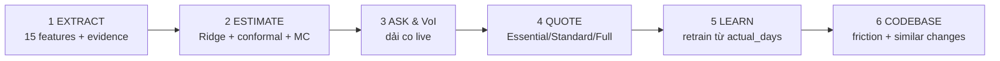
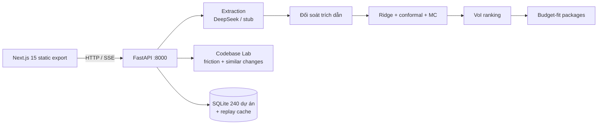

<div align="center">

# The Estimator
### From RFP to Calibrated Effort Range

[](https://the-estimator-xqzc.onrender.com)
[](https://github.com/iknizzz1807/the-estimator)
[-FF4B4B?style=for-the-badge)](https://github.com/iknizzz1807/the-estimator)

[](https://www.python.org/)
[](https://fastapi.tiangolo.com/)
[](https://nextjs.org/)
[](LICENSE)
[-success?style=flat-square)](backend/tests/)

**Dán email/RFP của khách → dải nỗ lực P10/P50/P90 đã hiệu chuẩn, câu hỏi làm rõ đáng hỏi nhất và báo giá theo ngân sách — LLM chỉ đọc, toán học ước lượng, mọi con số đều đo được.**

**Live:** [the-estimator-xqzc.onrender.com](https://the-estimator-xqzc.onrender.com) · **Repo:** [github.com/iknizzz1807/the-estimator](https://github.com/iknizzz1807/the-estimator)

</div>

## Vấn đề & giải pháp

Ước lượng từ RFP là canh bạc của mọi software agency: ước lượng sai làm lỗ **15–30% margin** hợp đồng; không phát hiện thông tin thiếu gây **scope creep 20–40% effort** ([`docs/SPEC.md`](docs/SPEC.md)). Trả về **một con số cố định** là tự sát quản trị rủi ro — mọi ước lượng từ yêu cầu chưa rõ bản chất là một phân phối xác suất, không phải hằng số.

Chatbot "hỏi thẳng LLM bao nhiêu ngày" thất bại vì hai lý do **đo được**: (1) LLM bịa số và bị neo tâm lý — thấy ngân sách trong email là đoán ra số ngày khớp ngân sách đó; (2) LLM lẫn **calendar time với person-days** — trên 42 bước walk-forward, LLM-only sai **258.12 ngày** MAE. Ở T=0, LLM còn tiền định (5 lần lặp cùng email: `[180, 180, 180, 180, 180]`, std 0.000): sai số đến từ **hiệu chuẩn**, không phải phương sai.

**The Estimator** tách hoàn toàn hai vai: **LLM chỉ đọc** (trích 15 feature độ phức tạp + trích dẫn nguyên văn, hiểu phủ định, không rõ → `null`, không đoán mò) và **toán học ước lượng** (Ridge + conformal prediction + Monte Carlo). Thông tin thiếu không bị đoán bừa — câu hỏi xếp hạng theo *Value of Information* và dải nỗ lực co lại ngay khi trả lời. Giao diện là dashboard workflow một URL, không phải chatbot.

## Bằng chứng đo được (không phải marketing)

Walk-forward replay trên 240 dự án demo (228 đã hoàn thành, 218 bước), DeepSeek V4.1 Flash, T=0. Nguồn: [`AB_MEASUREMENT.md`](docs/AB_MEASUREMENT.md) · [`EXTRACTION_EVAL.md`](docs/EXTRACTION_EVAL.md) · [`SURCHARGE_CALIBRATION.md`](docs/SURCHARGE_CALIBRATION.md) · [`CODEBASE_HISTORY_VALIDATION.md`](docs/CODEBASE_HISTORY_VALIDATION.md).

| Phép đo (đo thật, tái lập được) | The Estimator | Baseline |
|---|---|---|
| MAE walk-forward, 218 bước | **17.36 ngày** | Team người: 32.93 |
| Coverage P10–P90 (mục tiêu 75–85%) | **86.7%** (189/218) | — |
| MAE 42 bước gần nhất | 19.25 | Team 42.45 · LLM + lịch sử 35.27 · **LLM-only 258.12** |
| Hậu drift năng suất +22% (10 dự án cuối) | **31.05** | Team: 52.90 (coverage 7/10) |
| Extraction micro-F1 vs ground truth | **0.933** (DeepSeek, 236/240 email chấm điểm) | Stub regex: 0.845 (đủ 240) |
| Negation "không cần X" → 0 | **100.0%** (214/214) | Stub: 43.1% (94/218) |
| Unknown accuracy (feature bị lược khỏi email) | 99.0% (103/104) | Stub: 98.1% (102/104) |
| Codebase friction → change size (29,059 commit) | `e^β` ×1.12–×2.05 mỗi +1.0 friction, 4/4 repo | — |
| Similar changes → kích thước patch (29,058 commit) | **−2.8% MAE** vs repo-median, CI [−0.0602, −0.0222] | — |
| Chi phí extraction cả batch 240 email | $0.2005 / $0.1002 (peak/off-peak) | Stub: $0.00 |

## Luồng 6 bước



1. **Extract** — DeepSeek V4.1 Flash (hoặc stub offline) đọc email → 15 feature `true/false/null` + **trích dẫn nguyên văn** (đối soát fuzzy, ngưỡng 85% — dưới ngưỡng thì bỏ quote và giảm confidence). Hiểu phủ định: *"không cần mobile app"* → `mobile_app = false`.
2. **Estimate** — Ridge α=0.3 trên log(days) + split-conformal → P10/P50/P90 (sàn 3.0 person-days). Feature `null` được **Monte Carlo 2.000 vòng** lấy mẫu từ tần suất lịch sử → dải giãn ra trung thực (`method: "mc"`), **không bao giờ** gán mặc định 0.
3. **Ask & VoI** — top-5 câu hỏi xếp hạng theo ΔP50; bấm Có/Không → dải co ngay (ví dụ: độ bất định tương đối 1.99 → 1.38); trả lời hết → `method: "point"`.
4. **Quote** — nhập ngân sách → 3 gói Essential/Standard/Full + xác suất vượt ngân sách (khớp Lognormal trên dải conformal) + pricing curve.
5. **Learn** — nhập `actual_days` → retrain tức thì + audit trail hệ số; chứng minh thích nghi drift +22% (2026-02) trong khi ước lượng con người tụt lại.
6. **Codebase Lab (tùy chọn)** — dán URL GitHub công khai (allow-list, chống SSRF) hoặc chọn ví dụ có sẵn → friction + commit tương đồng → phụ phí **một chiều** (*surcharge only, never discount*). Lỗi repo không làm mất estimate.

<details>
<summary><b>15 features taxonomy (hệ số sinh dữ liệu & tần suất)</b></summary>

| Nhóm | Feature | Hệ số | P(present) |
|---|---|---|:---:|:---:|
| Integration | `third_party_api` | ×1.35 | 45% |
| Integration | `payment_gateway` | ×1.45 | 25% |
| Integration | `identity_provider` | ×1.25 | 25% |
| Integration | `external_data_sync` | ×1.30 | 30% |
| Data | `data_migration` | ×1.60 | 30% |
| Data | `multi_currency` | ×1.15 | 15% |
| Data | `multi_tenancy` | ×1.50 | 20% |
| UI | `realtime_ui` | ×1.30 | 25% |
| UI | `mobile_app` | ×1.55 | 25% |
| UI | `offline_mode` | ×1.25 | 20% |
| Security | `pci_dss` | ×1.40 | 20% |
| Security | `privacy_compliance` | ×1.35 | 25% |
| Security | `audit_logging` | ×1.20 | 20% |
| Context | `legacy_tech_stack` | ×1.45 | 20% |
| Context | `cross_team_coordination` | ×1.25 | 25% |

Tương tác phi tuyến: `payment_gateway`×`pci_dss` ×1.15 · `mobile_app`×`offline_mode` ×1.10 · `data_migration`×`legacy_tech_stack` ×1.12. ~30% email bỏ sót 1–2 feature (76/240 = 31.7%); 218 ô phủ định. Chi tiết: [`docs/DATA_GENERATION.md`](docs/DATA_GENERATION.md).

</details>

<details>
<summary><b>Kiến trúc chi tiết (single service, 1 cổng)</b></summary>



- Một web service duy nhất: FastAPI mount static export của Next.js 15 (`/`, `/estimate`, `/history`, `/proof`) + REST/SSE (`/api/estimate`, `/api/actuals`, `/api/ab`...). Không CORS, không database ngoài (D12).
- Provider pluggable: `deepseek | stub | distilled | gemini | openai`; không có key vẫn chạy 100% offline bằng stub tiền định. SSE stream phát 6 bước: `extracting → validating → similar → estimating → questions → done`.
- Codebase Lab: git history (churn 180 ngày, author concentration) + AST Python (fan-in, radon complexity) + coverage-gap + commit tương đồng; demo repos / 5 repo Python pre-cloned (Flask, Click, Requests, Stripe SDK, SMART-on-FHIR) / repo của chính dự án / URL dán vào (D21–D27).

</details>

## Codebase Lab — giải thích rủi ro, không hứa dự đoán

- **Friction score** từ tín hiệu thật của repo: `0.30·churn + 0.15·fan_in + 0.30·complexity + 0.10·coverage_gap + 0.15·author_concentration` (churn saturate 20 commit/6 tháng; fan-in & complexity là tín hiệu Python-only).
- **Commit tương đồng**: production so khớp từ khóa trên path các commit quá khứ; cơ chế được validate offline ("similar-message → median", Jaccard, K=5) thắng baseline repo-median **−2.8% MAE** trên **29,058 target**.
- **Surcharge một chiều** (không bao giờ giảm giá): `P10 × (1 − 0.30·F)` (sàn 0.55), `P50 × (1 + 0.35·modified_ratio)` (cap 1.50), `P90 × (1 + 0.60·F)` (cap 1.90). Hướng + độ lớn đo trên **29,059 commit thật** (D20); mắt xích *size → person-days* chưa đo được từ dữ liệu công khai → hệ số gắn nhãn `DEMO-ASSUMED` trong mọi response.
- **Python-only, enforced** (D24): repo không phải Python bị từ chối kèm thông báo rõ, thay vì cho điểm sai. Thêm repo bằng 1 click ví dụ hoặc dán URL (allow-list `github.com`, chống SSRF).
- **SWE-bench nói thẳng**: thêm tín hiệu codebase **không** giảm MAE (1.389 vs 1.318) → module chỉ ở vị thế "giải thích rủi ro", không claim dự đoán ([`docs/CODEBASE_VALIDATION.md`](docs/CODEBASE_VALIDATION.md)).

## Quyết định then chốt (D1–D29)

Nhật ký đầy đủ 28 quyết định đã ghi (D19 để trống cho retrieval coupling): [`docs/DECISIONS.md`](docs/DECISIONS.md). Những cái một judge cần biết:

| Quyết định | Vì sao (một dòng) |
|---|---|
| **D2/D10** — Provider pluggable; mặc định DeepSeek V4.1 Flash; zero-key = stub offline | Extraction thật khi có key; test/replay/demo 100% offline và deterministic |
| **D3** — Không torch/sentence-transformers (BM25 + TF-IDF + rapidfuzz) | Chạy được trong 512 MB (Render) và máy yếu; thay embedding sau qua cùng interface |
| **D4/D13** — Dữ liệu synthetic, seed 42, công khai; ground truth không bao giờ được đọc | Tái lập từng byte; đo được extraction mà không rò rỉ tương lai |
| **D8** — Ridge α=0.3 trên log(days) + conformal | CV sweep (52 dự án seed): MAE walk-forward 12.58 → 10.70; trả về dải, không phải một con số |
| **D11** — Monte Carlo cho unknowns + câu hỏi Có/Không co dải + gói ngân sách | Thông tin thiếu phải làm dải giãn ra trung thực thay vì gán mặc định 0 |
| **D12** — Single-service: FastAPI phục vụ static Next.js export | Bỏ CORS và chế độ hỏng hai dịch vụ; một container, một URL |
| **D15** — Codebase Lab = "giải thích rủi ro", phụ phí một chiều | Codebase sạch không bao giờ được giảm giá → tránh under-quoting |
| **D20** — Hiệu chuẩn phụ phí trên 29,059 commit thật | Hướng + độ lớn friction→size/spread được đo; mắt xích size→person-days vẫn là giả định, ghi rõ |
| **D21** — Dán URL GitHub công khai + suy giảm nhẹ nhàng | Repo lỗi chỉ trả `codebase_error`, không làm mất estimate; allow-list chống SSRF |
| **D22/D24** — Codebase Lab chỉ Python, ép buộc bằng gate | Thà từ chối còn hơn cho điểm lệch (non-Python từng bị kéo xuống ~2×) |
| **D18** — Retrieval display-only (chưa nối vào estimate) | Gate recall đã pass nhưng chưa có ablation chứng minh cải thiện MAE → không nối số |
| **D14/D26** — Gate đặt trước; kết quả âm tính công bố | Luật của repo: ablation fail thì không claim; mọi số phải có artifact trong `docs/` |

## Quickstart (3 lệnh)

```bash
git clone https://github.com/iknizzz1807/the-estimator.git && cd the-estimator/backend
python -m venv .venv && . .venv/bin/activate && pip install -r requirements.txt
bash scripts/run_api.sh   # http://localhost:8000 (API-only nếu chưa build UI)
```

- Mặc định **offline stub** (`LLM_PROVIDER=stub`): không cần key, deterministic; `python -m pytest tests/ -q` → **242 passed**.
- Muốn LLM thật: `cp .env.example .env` → điền `DEEPSEEK_API_KEY` + `LLM_PROVIDER=deepseek`.
- Deploy: `docker build -f backend/Dockerfile -t the-estimator . && docker run -p 8000:8000 the-estimator`; Render: Blueprint từ [`render.yaml`](render.yaml), health-check `/api/health`.

<details>
<summary><b>Cấu trúc thư mục (repo layout)</b></summary>

```
the-estimator/
├── backend/                  # FastAPI, mô hình toán & Codebase Lab
│   ├── app/
│   │   ├── api/              # REST endpoints & SSE stream
│   │   ├── data_gen/         # Generator 240 dự án (seed 42)
│   │   ├── services/         # estimation, extraction, codebase, voi, replay...
│   │   ├── features.py       # Single source of truth cho 15 features
│   │   └── main.py           # Entrypoint & mount Next.js export
│   ├── scripts/              # Đo lường A/B, hiệu chuẩn, kiểm chứng
│   ├── tests/                # 242 bài kiểm thử offline
│   └── Dockerfile            # Multi-stage production container
├── frontend/                 # Next.js 15 (TailwindCSS, Recharts)
│   ├── app/                  # /estimate, /history, /proof
│   └── components/           # CodebasePanel, VoI, feature cards...
├── data/                     # synthetic_history.csv + ground_truth.json
├── docs/                     # 16 tài liệu đặc tả & báo cáo thực nghiệm
└── render.yaml               # Blueprint triển khai Render
```

</details>

## Hạn chế & kết quả âm tính (nói thẳng)

- **Dữ liệu demo là synthetic** (240 dự án, seed 42, công thức ẩn): văn phong RFP thật đa dạng hơn; ground truth không bao giờ được đọc bởi estimator.
- **Hệ số Codebase Lab một phần là giả định demo**: ×0.30/×0.60 giãn dải, ×0.35 dịch P50 — hướng đã đo trên 29,059 commit thật, nhưng mắt xích *change size → person-days* chưa đo được từ dữ liệu công khai.
- **5 kết quả âm tính được công bố đầy đủ**: TAWOS R² = −0.021 · SWE-bench text-prediction 1.318 vs 1.389 · Itemlet 6.5% logging · PR lead-time β = −0.892 · Distillation F1 0.442 vs 0.923.
- **Codebase Lab chỉ Python** (gate ép buộc): repo không phải Python bị từ chối kèm thông báo, thay vì cho điểm sai; `fan_in`/`complexity` là tín hiệu Python-only.
- **Retrieval (D18) chưa nối vào estimate**: gate đã pass (analog hit@10 0.650–0.807, locate hit@10 0.683–0.776) nhưng hiện chỉ display-only.
- **Vận hành**: `/api/estimate` chưa có auth/rate-limit; SQLite trên Render free tier là ephemeral (cold start reseed 240 dự án); mỗi click trả lời câu hỏi re-run extraction (~2–3 s, 1 API call — D29).
- **Nguồn số liệu**: DeepSeek gọi thật, một lần chạy (stub: `identical` qua 2 lần chạy); replay có baseline LLM-only mô phỏng bên trong — không dùng cho bảng trên.

<details>
<summary><b>Chi tiết 5 kết quả âm tính (số liệu đầy đủ)</b></summary>

1. **TAWOS** ([`docs/TAWOS_VALIDATION.md`](docs/TAWOS_VALIDATION.md)) — 5,850 Jira issues / 39 dự án: R² = −0.021, MAE 2.48 SP, chỉ hòa baseline trung vị toàn cục (2.48 SP). Story points ≠ person-days.
2. **SWE-bench** ([`docs/CODEBASE_VALIDATION.md`](docs/CODEBASE_VALIDATION.md)) — 2,294 instances; ablation n=150 (sympy): text-only MAE 1.318 vs text+codebase 1.389 → thêm tín hiệu codebase **không** cải thiện. Module giữ vị thế "risk explanation".
3. **Itemlet** ([`docs/ITEMLET_VALIDATION.md`](docs/ITEMLET_VALIDATION.md)) — 114 dự án thật: coverage 76.3–86.0% (đạt mục tiêu 75–85%), nhưng chỉ **6.5%** tổng số issues có log giờ; subset cov ≥ 10% (n=37): R² = 0.364.
4. **PR lead-time** ([`docs/PR_LEADTIME_VALIDATION.md`](docs/PR_LEADTIME_VALIDATION.md)) — 3,240 merged PRs: β = −0.892 (CI [−1.263, −0.507]); median lead time 0.30–0.64 ngày (hầu hết PR merge trong ngày) → **bác bỏ hoàn toàn**, không hệ số sản phẩm nào lấy từ đây.
5. **Distillation** ([`docs/DISTILLATION_EXPERIMENT.md`](docs/DISTILLATION_EXPERIMENT.md)) — student micro-F1 **0.442** vs teacher 0.923, đường cong bão hòa ở n=240 → chưa đủ dữ liệu để thay LLM ở quy mô demo.

</details>

## Tài liệu (16 docs)

| Tài liệu | Nội dung |
|---|---|
| [`SPEC.md`](docs/SPEC.md) | Đặc tả nghiệp vụ & toán học |
| [`API.md`](docs/API.md) | API contract & schema |
| [`DECISIONS.md`](docs/DECISIONS.md) | Nhật ký D1–D29 (28 ghi, D19 để trống) |
| [`DATA_GENERATION.md`](docs/DATA_GENERATION.md) | Sinh dữ liệu & ground truth |
| [`SUBMISSION.md`](docs/SUBMISSION.md) | Bài nộp hackathon (EN + VI) |
| [`AB_MEASUREMENT.md`](docs/AB_MEASUREMENT.md) | 4 baseline & độ ổn định T=0 |
| [`EXTRACTION_EVAL.md`](docs/EXTRACTION_EVAL.md) | Extraction vs ground truth (15 features) |
| [`SURCHARGE_CALIBRATION.md`](docs/SURCHARGE_CALIBRATION.md) | Hiệu chuẩn phụ phí trên 29,059 commit |
| [`CODEBASE_HISTORY_VALIDATION.md`](docs/CODEBASE_HISTORY_VALIDATION.md) | Similar changes: dương tính (−2.8% MAE) |
| [`CODEBASE_VALIDATION.md`](docs/CODEBASE_VALIDATION.md) | SWE-bench text-prediction: âm tính |
| [`TAWOS_VALIDATION.md`](docs/TAWOS_VALIDATION.md) | TAWOS: âm tính (R² ≈ −0.02) |
| [`ITEMLET_VALIDATION.md`](docs/ITEMLET_VALIDATION.md) | Itemlet: 114 dự án thật (6.5% logging) |
| [`PR_LEADTIME_VALIDATION.md`](docs/PR_LEADTIME_VALIDATION.md) | PR lead-time: bị bác bỏ (β = −0.892) |
| [`DISTILLATION_EXPERIMENT.md`](docs/DISTILLATION_EXPERIMENT.md) | Chưng cất: F1 0.442 vs 0.923 |
| [`RETRIEVAL_VALIDATION.md`](docs/RETRIEVAL_VALIDATION.md) | Change retrieval: gate PASS, chưa nối |
| [`USER_JOURNEY_GUIDE_PROPOSAL.md`](docs/USER_JOURNEY_GUIDE_PROPOSAL.md) | Thiết kế UI/UX & onboarding |

<div align="center">

**The Estimator — Engineering calibrated software effort ranges with honesty and rigor.**
*Đội thi "Agent in the Shell" (Challenge #2) — Anduin Cybernetics.*

</div>
