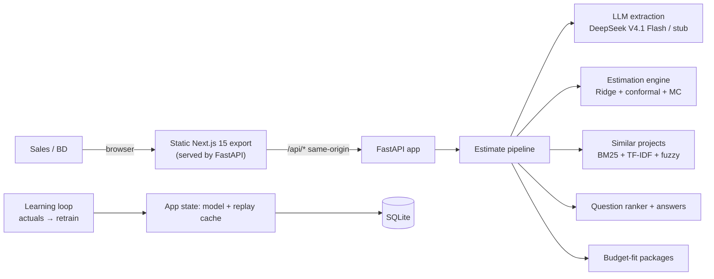

# The Estimator

**From RFP to range** — paste a customer email, get a calibrated effort estimate (P10/P50/P90), the highest-impact clarifying questions, a budget-fit quote, and a learning loop that improves with every finished project.

> **Hackathon submission** — *Agent in the Shell* (Anduin Cybernetics) · Challenge #2: The Estimator.
> Demo data is **synthetic** (with drift, interactions and outliers) and estimates are always a **range**, not a promise. See [Honest limitations](#honest-limitations).

**Docs:** [business spec](docs/SPEC.md) · [API contract](docs/API.md) · [decision log](docs/DECISIONS.md) · [data generation](docs/DATA_GENERATION.md) · [measured A/B](docs/AB_MEASUREMENT.md) · [extraction quality](docs/EXTRACTION_EVAL.md) · [TAWOS cross-check](docs/TAWOS_VALIDATION.md) · [Itemlet check](docs/ITEMLET_VALIDATION.md) · [codebase mechanism ✓](docs/CODEBASE_HISTORY_VALIDATION.md) · [codebase text-prediction ✗](docs/CODEBASE_VALIDATION.md) · [surcharge calibration](docs/SURCHARGE_CALIBRATION.md) · [PR lead-time ✗](docs/PR_LEADTIME_VALIDATION.md) · [LLM→classifier](docs/DISTILLATION_EXPERIMENT.md)

## Tóm tắt tiếng Việt

Dán email/RFP của khách → LLM (DeepSeek V4.1 Flash) trích xuất **15 features** kèm trích dẫn gốc, phần **toán** (Ridge Regression + Conformal Prediction) trả về **khoảng P10/P50/P90**. Thông tin còn thiếu không bị đoán bừa: feature "không rõ" được **lấy mẫu Monte Carlo** làm khoảng giãn ra trung thực, và bạn có thể **bấm trả lời từng câu hỏi → khoảng co lại ngay trên màn hình**. Có thêm **gói báo giá theo ngân sách** (Essential/Standard/Full + xác suất vượt budget), vòng lặp học từ số ngày thực tế (có cú drift giữa chừng để chứng minh thích nghi), màn **Proof** đo thật: System vs Team vs LLM-only vs **LLM + lịch sử công ty**. Thêm lớp **Codebase Lab**: trỏ vào repo → đo ma sát cấu trúc + lịch sử thay đổi tương tự → giãn khoảng cảnh báo rủi ro (*risk explanation* — cơ chế đã validate dương tính trên 29k commit thật, không claim tăng độ chính xác). Chạy offline được bằng stub extractor; gắn key là chạy LLM thật ngay.

## The problem

- Effort estimates rely on Tech Lead gut feeling; nothing is learned from past projects.
- Missing requirements cause 20–40% scope creep; wrong estimates burn 15–30% of project margin.
- Estimating takes 1–3 hours per RFP — too slow to answer the customer in time.

## How it works

1. **Extract** — an LLM reads the email/RFP and extracts 15 binary features with verbatim evidence quotes (verified with fuzzy matching; unclear items stay `unknown`, never guessed).
2. **Estimate** — math, not the LLM, produces the estimate: Ridge regression on `log(days)` + conformal prediction → **P10/P50/P90**. Unknown features are **sampled by Monte Carlo** (historical prevalence) so missing information widens the interval honestly (`method:"mc"`).
3. **Ask & refine** — unknowns are ranked by impact in days; each question has Yes/No buttons, and **the range shrinks live** as answers come in (`method` flips to `"point"` when the vector is fully known).
4. **Quote** — enter the customer's budget → three scope packages (Essential / Standard / Full) with **over-budget probability**, built by phasing out the most expensive optional capabilities.
5. **Learn** — entering actual days retrains the model, updates per-feature coefficients (audit trail) and re-scores accuracy. A mid-history **productivity drift** (+22% from 2026-02) proves the loop adapts while human estimates don't.
6. **Prove** — walk-forward Replay (System / Team / LLM-only / **LLM + company history**) and a live A/B comparison — all measured, no hand-waving.
7. **Context (optional)** — point the estimate at a codebase: structural friction (churn, fan-in, complexity, coverage, authors) widens the range; similar past changes measure invasiveness and add a risk surcharge to P50. Risk explanation, never a discount; coefficients are demo-assumed (learned from actuals in production).

## Architecture (single service)



Design notes:

- **One service, one URL** — FastAPI serves the statically-exported frontend and the API on the same port: no CORS, no split deploy. A **"Reset demo data"** button reseeds the 240-project demo DB atomically (judges never corrupt each other's runs).
- **LLM extracts, math estimates** — same input → same output, auditable coefficients, no anchoring bias.
- **Replay is computed once at startup** (walk-forward over all history) and cached for the History and Proof screens.
- **SSE streaming** shows the pipeline steps live on the Estimate screen.

## Measured results (real runs, not marketing)

Walk-forward replay on the seeded 240-project history (228 done, 218 replay steps), LLM = DeepSeek V4.1 Flash:

| Baseline | MAE (days) | Rows | Notes |
|---|---|---|---|
| **System (calibrated P50)** | **17.36** | 218 | full walk-forward; coverage 189/218 (86.7%) |
| Team estimate | 32.93 | 218 | full walk-forward; ignores the mid-history drift |
| LLM + company history in prompt | 35.27 | 42 | most recent steps; the fair "LLM with context" strawman |
| LLM-only | 258.12 | 42 | most recent steps; confuses calendar time with effort (measured MAE 258 vs 17.4 for the system) |

Post-drift window (last 10 steps): **System 31.05 vs Team 52.90 MAE** — the model re-learns after the productivity shift; the humans keep the old habits. Full report: [docs/AB_MEASUREMENT.md](docs/AB_MEASUREMENT.md).

Variance probe: the same email asked 5× at temperature 0 returned identical numbers (std = 0.000) — the LLM's problem at temperature 0 is **calibration, not variance**. The system's edge is calibration, auditability and learning.

Extraction quality (240 emails with known ground truth, 3600 cells):

| Metric (micro) | Stub (offline) | DeepSeek |
|---|---|---|
| Precision | 0.825 | **0.986** |
| Recall | 0.867 | 0.886 |
| F1 | 0.845 | **0.933** |
| Negation handling ("no mobile app") | 43.1% | **100%** |

Full report: [docs/EXTRACTION_EVAL.md](docs/EXTRACTION_EVAL.md). Cost: the whole 240-email batch costs ≈ **$0.20** peak / **$0.10** off-peak on `deepseek-flash`.

## Codebase Lab — risk context (validated honestly)

Same email, two codebases, two different answers (live demo — repo selector on the Estimate screen; demo repos analyzed at their pinned reference date 2026-04-01, base range {10, 20, 40}):

| | `payment_plugin` (clean) | `payment_spaghetti` (messy) |
|---|---|---|
| Friction (churn/fan-in/complexity/authors/coverage) | 0.21 LOW | 0.69 HIGH |
| Invasiveness of similar past changes | 36% files modified | **86% files modified** |
| Range | {9.4, 22.5, 45.0} | {7.9, **26.0**, 56.5} |

What is validated (and what is not):

- **YES — the mechanism**: "similar past changes predict the next change's size" beats the repo-median baseline on **29,058 real commits** (sympy/pytest/requests/flask): −2.8% MAE, 95% CI excludes 0, Spearman 0.323 vs 0.034; oracle upper bound 0.881. [docs/CODEBASE_HISTORY_VALIDATION.md](docs/CODEBASE_HISTORY_VALIDATION.md)
- **NO — text prediction**: predicting a patch's invasiveness from issue text (± codebase signals) did not improve on SWE-bench, even on the 571-instance multi-file subset — so this module is a **risk explanation, not an accuracy claim**. [docs/CODEBASE_VALIDATION.md](docs/CODEBASE_VALIDATION.md)
- **One click, real repos**: five real **Python** repositories (Flask, Click, Requests, Stripe SDK, SMART-on-FHIR) are pre-cloned at image build and offered as chips — click and get a result **instantly**, no URL to paste (the two demo repos are synthetic; these are real). They run the same live analysis as a pasted repo.
- **Paste a repo**: the selector also accepts a **public GitHub URL** (`https://github.com/<owner>/<repo>` or `owner/repo`), cloned once into a cache and analysed identically — the customer's codebase, not just our own. Acceptance is a strict `github.com` allow-list (SSRF-safe: no other host/scheme/port), the clone is bounded (180 s, 300 MB, LRU-cached), and a repository problem **never** fails the estimate — the numbers come back with a `codebase_error` note. `This project` is hidden where the host has no `.git` (cloud builds).
- **One-directional by design**: friction/invasiveness can only widen the range and add a surcharge — never a discount (safe against under-quoting; discounts would need coefficients learned from real actuals).
- The adjustment coefficients (×0.30/×0.60 widening, ×0.35 invasiveness shift) are **demo-assumed and labeled as such** in every API response. Their **direction is now measured** on 29,059 real commits ([docs/SURCHARGE_CALIBRATION.md](docs/SURCHARGE_CALIBRATION.md)): friction → change size passes on 4/4 repos (`e^β` ×1.12–×2.05), friction → spread on 3/4 (the interval-widening claim; `requests` is the exception), rank signal on 4/4 — but the last link (change size → **person-days**) needs `(repo signals, actual days)` pairs, which no public dataset has, so the *magnitude* stays an assumption until a pilot measures it.

## Why this is not "just an LLM wrapper"

| Criterion | LLM-only (measured) | This system |
|---|---|---|
| Consistency | Deterministic at T=0, but wrong scale | Same input → same output, calibrated scale |
| Uncertainty | A single number | P10/P50/P90; measured coverage 86.7% |
| Missing info | Silently guesses | MC-widened range + ranked questions; answers shrink it live |
| Learning | None | Retrains on actuals; adapts after drift (31.05 vs 52.90 MAE) |
| Auditability | Opaque | Coefficients, evidence quotes, similar projects |
| Cost | ~$0.20/batch | LLM only for extraction; estimation is free math |

## The 15 features

Integration: `third_party_api`, `payment_gateway`, `identity_provider`, `external_data_sync` ·
Data: `data_migration`, `multi_currency`, `multi_tenancy` ·
UI: `realtime_ui`, `mobile_app`, `offline_mode` ·
Security: `pci_dss`, `privacy_compliance`, `audit_logging` ·
Context: `legacy_tech_stack`, `cross_team_coordination`

(Canonical definitions: [`backend/app/features.py`](backend/app/features.py))

## Quickstart (local, single port)

```bash
# Backend + UI on http://localhost:8000
cd backend
python3 -m venv .venv && . .venv/bin/activate   # first time
pip install -r requirements.txt
bash scripts/run_api.sh
```

The frontend build is served from `frontend/out` when present (build it once with `cd frontend && npm install && npm run build`; on this Android device see [DECISIONS D7+D12](docs/DECISIONS.md) for the FUSE build workaround). Without a build the server runs API-only. No API key needed (stub extractor); copy `.env.example` → `.env` and set `DEEPSEEK_API_KEY` for real LLM extraction. `npm run dev` still works for UI development against `:8000`.

## Demo scenarios (1-click)

Three realistic RFPs ship with the app (Onboarding → **Load Sample Data**): **A** fintech (payments + PCI + mobile + real-time), **B** healthcare (legacy data migration, HIPAA, audit trail), **C** marketplace (multi-currency, multi-tenancy, SSO, vendor sync).

## Proof screens

- **Replay** — walk-forward MAE chart (System / Team / LLM-only), coverage `189/218 (86.7%)`, per-step P10/P50/P90 vs actual.
- **A/B** — 10 repeated LLM-only runs vs **LLM + company history** vs system, with a "simulated" badge whenever the offline stub is used.

## Tests

**239 backend tests** — offline, deterministic, stub-forced:

```bash
cd backend && python -m pytest tests/ -q
```

## Honest limitations

1. **Demo data is synthetic** — regenerated with interactions, mid-history drift (+22% from 2026-02) and 5% outliers; ground truth is excluded from all services and used only for evaluation.
2. **Story point ≠ person-day** — the TAWOS cross-dataset check showed no signal under the offline stub (documented negative result: [docs/TAWOS_VALIDATION.md](docs/TAWOS_VALIDATION.md)).
3. **Extraction can err** — measured: F1 0.933 (DeepSeek) / 0.845 (stub); weak spots are indirect features (`cross_team_coordination`, `audit_logging`).
4. **Conformal prediction assumes exchangeability** — distribution shift can degrade coverage.
5. **No Jira/GitHub integration** — demo imports CSV only.
6. **No auth / multi-user** — the demo DB is shared; the **Reset demo data** button restores the pristine 240-project state.
7. **Baselines labeled honestly** — the LLM-only replay baseline is simulated when no key is present; the LLM+history baseline and the A/B run are real with a key (see badges in the UI).
8. **Similar projects retrieval** uses BM25 + TF-IDF (no embeddings) to keep the on-device build light.
9. **Free-tier hosting** — on Render the SQLite file is ephemeral: the demo reseeds on every restart; entered actuals are lost on cold start (use Reset to restore deliberately).
10. **Interval width is not strictly monotone per single answer** — answering "yes" to an expensive feature raises P50 (absolute width can grow); the *relative* uncertainty always shrinks (live-measured 1.99 → 1.38).
11. **Codebase adjustments are one-directional; the surcharge magnitude is partly measured, partly assumed** — friction → change size and friction → spread are now measured on 29,059 real commits ([docs/SURCHARGE_CALIBRATION.md](docs/SURCHARGE_CALIBRATION.md); the spread gate holds on 3 of 4 repos, reported as-is), but the final link (change size → person-days) is **not** measurable from public data and stays an explicit assumption until a pilot records (repo signals + actual days) pairs; a clean repo never gets a discount today. A public-data workaround was tried and **rejected**: PR lead time does not predict effort ([docs/PR_LEADTIME_VALIDATION.md](docs/PR_LEADTIME_VALIDATION.md)).
12. **Itemlet cross-check** — on 114 real projects with logged hours (of 204) the conformal intervals calibrated correctly (coverage 76–86%) but the point estimate tied the median baseline: only 6.5% of issues have logged time, so the binding constraint is data quality, not the estimator ([docs/ITEMLET_VALIDATION.md](docs/ITEMLET_VALIDATION.md)).
13. **LLM→classifier distillation is not there yet** — a student trained on 240 LLM-labeled emails reaches F1 0.44 vs the teacher's 0.92 and has plateaued; replacing the LLM needs far more (and real) data ([docs/DISTILLATION_EXPERIMENT.md](docs/DISTILLATION_EXPERIMENT.md)).
14. **Codebase Lab is Python-only (enforced)** — `fan_in` (import scan) and `complexity` (radon) are Python signals, so a repository whose primary source language is not Python is **refused** with a clear message instead of being mis-scored (a C library with 2 stray test scripts once reported `complexity` 0.75). Every block reports `language` (Python share) so the analysed scope is visible, and multi-language support is a stated later feature — not a silent approximation. ([docs/DECISIONS.md](docs/DECISIONS.md) D22/D24.)

## We do NOT claim

- "100% accurate"
- "Replaces humans" — it prepares ranges and questions for humans to decide
- "Works for every kind of project"
- "Works without historical data" — cold start still detects missing info and normalizes RFPs, but calibrated ranges need history

## Tech stack

| Layer | Choice |
|---|---|
| Frontend | Next.js 15 (static export) + TailwindCSS + Recharts — dark, workflow-first, no chat UI |
| Backend | FastAPI (Python 3.13) + SSE, serves the UI on the same port |
| AI | DeepSeek V4.1 Flash (default) / Gemini / OpenAI — pluggable + deterministic offline stub |
| Math | scikit-learn Ridge (α=0.3) + split conformal prediction + Monte Carlo over unknowns |
| Codebase | git log + radon + import scan (no LLM ever reads the code) — friction + invasiveness on demo repos |
| DB | SQLite (auto-seeded, atomic reset) |
| Deploy | One Render Docker web service (`render.yaml`), free tier |

## Deploy

**Render (single service)**: New → Blueprint → pick this repo — [`render.yaml`](render.yaml) builds the repo-root Docker image (frontend built inside), health-checks `/api/health` and serves UI+API on one URL. Set `LLM_PROVIDER=deepseek` + `DEEPSEEK_API_KEY` in the dashboard for real LLM extraction (stub otherwise).

Alternative: `docker build -f backend/Dockerfile -t the-estimator . && docker run -p 8000:8000 the-estimator`. Vercel is no longer needed (kept as a fallback: host `frontend/out` anywhere and set `NEXT_PUBLIC_API_URL` + `CORS_ORIGINS` at build/deploy time).

## Repo layout

```
backend/   FastAPI app (app/api, app/services), tests, scripts
frontend/  Next.js 15 UI (static export into frontend/out, gitignored)
data/      synthetic history + ground truth (db is gitignored, auto-seeded; tawos subset)
docs/      SPEC, API contract, decisions, measured reports (AB, extraction, TAWOS, Itemlet, codebase ×2, distillation, data-gen)
```

## License

TBD before submission.
