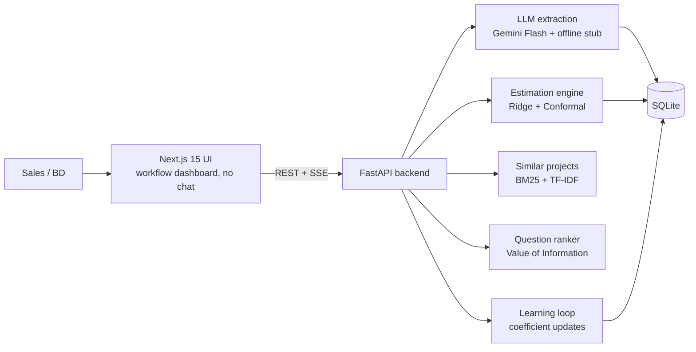

# The Estimator

**From RFP to range** — paste a customer email, get an effort estimate as a calibrated range (P10/P50/P90), a ranked list of clarifying questions, and a learning loop that sharpens with every finished project.

> Submission for **Agent in the Shell** (Anduin Cybernetics) — Challenge #2: The Estimator.
> ⚠️ Status: in active development (hackathon build). Demo data is synthetic — see [Known limitations](#known-limitations).

**Live app:** _coming soon_ · **Docs:** [spec](docs/SPEC.md) · [API contract](docs/API.md)

## The problem

- Effort estimates rely on Tech Lead gut feeling; nothing is learned from past projects.
- Missing requirements cause 20–40% scope creep; wrong estimates burn 15–30% of project margin.
- Estimation takes 1–3 hours per RFP — too slow to answer the customer.

## How it works

1. **Extract** — An LLM reads the email/RFP and extracts 15 binary features (integration, data, UI, security, context) with verbatim evidence quotes.
2. **Estimate** — Math, not the LLM, produces the estimate: Ridge regression on `log(days)` + Conformal Prediction → **P10/P50/P90** range with a measurable coverage guarantee.
3. **Ask** — Unknown features are ranked by impact (Value of Information) and turned into ready-to-send clarifying questions.
4. **Learn** — Enter actual days when a project finishes; coefficients update with a moving average and accuracy trends become visible.
5. **Prove** — Replay history (walk-forward validation) and A/B vs LLM-only show that the system genuinely learns.

## Architecture



## Tech stack

| Layer | Choice |
|---|---|
| Frontend | Next.js 15 + TailwindCSS (dark, cyberpunk tone) |
| Backend | FastAPI (Python 3.13) + SSE streaming |
| AI | Gemini Flash (default) — pluggable provider, offline stub for demos/tests |
| Estimation | scikit-learn Ridge + split conformal prediction |
| DB | SQLite |
| Deploy | Vercel (frontend) + Render (backend) — TBD |

## Repo layout

```
backend/   FastAPI app + services (extraction, estimation, ...) + tests
data/      synthetic history + SQLite db (db is gitignored)
docs/      SPEC.md (business spec), API.md (contract), decisions, scenarios
frontend/  Next.js app (coming)
```

## Quickstart (local)

TBD — finalized once the backend API lands. Python deps: `backend/requirements.txt`.

## Known limitations

TBD — will mirror `docs/SPEC.md` §11 (synthetic demo data, story-point ≠ person-day, extraction can err, conformal exchangeability assumption, no Jira/GitHub API, no auth).
