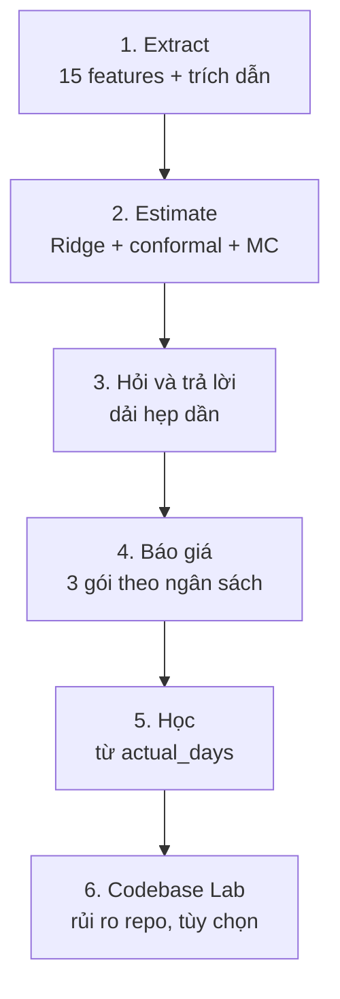
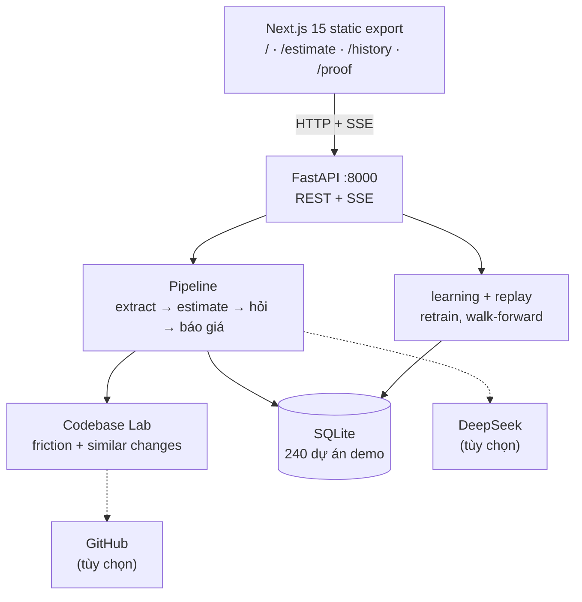

<div align="center">

# The Estimator
### From RFP to Calibrated Effort Range

[](https://the-estimator-xqzc.onrender.com)
[](https://github.com/iknizzz1807/the-estimator)
[-FF4B4B?style=for-the-badge)](https://github.com/iknizzz1807/the-estimator)

[](https://www.python.org/)
[](https://fastapi.tiangolo.com/)
[](https://nextjs.org/)
[](LICENSE)
[-success?style=flat-square)](backend/tests/)

</div>

The Estimator biến email yêu cầu của khách thành một dải nỗ lực P10/P50/P90 thay vì một con số duy nhất. Phân vai rõ ràng: LLM chỉ đọc hiểu văn bản, còn tính toán giao hết cho toán học.

Cụ thể, DeepSeek V4.1 Flash đọc email rồi bóc ra 15 đặc trưng độ phức tạp của dự án, mỗi đặc trưng phải kèm trích dẫn nguyên văn lấy từ email. Chỗ nào email không nói rõ thì để nguyên là "không biết", không đoán. Phần còn lại là Ridge regression trên log(days) để ước lượng, conformal prediction để dựng khoảng P10/P90, và Monte Carlo để xử lý những đặc trưng còn "không biết". Nhờ vậy thông tin thiếu không bị che đi, nó làm dải rộng ra, và mỗi câu hỏi được trả lời sẽ thu hẹp dải ngay trên màn hình.

Live: https://the-estimator-xqzc.onrender.com · Repo: https://github.com/iknizzz1807/the-estimator

## Các bước



1. Extract: LLM đọc email, trả về 15 feature dạng true/false/null kèm trích dẫn. Câu phủ định được xử lý đúng ("không cần mobile app" ra false).
2. Estimate: Ridge α=0.3 trên log(days), split conformal cho P10/P50/P90 (sàn 3 ngày). Feature còn null được Monte Carlo 2.000 vòng lấy mẫu theo tần suất lịch sử.
3. Hỏi và trả lời: xếp hạng câu hỏi theo mức ảnh hưởng lên P50, lấy top-5. Trả lời hết thì kết quả chuyển thành ước lượng điểm.
4. Báo giá: nhập ngân sách của khách, ra 3 gói Essential/Standard/Full kèm xác suất vượt ngân sách, cộng một đường cong giá để thương lượng.
5. Học: nhập actual_days, mô hình retrain và cập nhật hệ số. Dữ liệu demo có một cú drift năng suất +22% giữa chừng để thấy vòng lặp thích nghi còn ước lượng tay thì không.
6. Codebase Lab: dán URL GitHub công khai hoặc chọn repo có sẵn, hệ thống đọc git history để ước lượng rủi ro. Repo lỗi chỉ trả về cảnh báo chứ không làm mất kết quả estimate.

## Kiến trúc

Toàn bộ chạy trong một service duy nhất. Hai thứ duy nhất nằm ngoài (DeepSeek, GitHub) đều là tùy chọn.



## Kết quả

Replay walk-forward trên 240 dự án demo (228 đã hoàn thành, 218 bước), gọi DeepSeek thật ở temperature 0:

| Hạng mục | Kết quả | Tham chiếu |
|---|---|---|
| MAE (P50), toàn bộ 218 bước | 17.36 ngày | team ước lượng tay: 32.93 |
| Coverage P10–P90 | 86.7% (189/218) | mục tiêu 75–85% |
| MAE 42 bước gần nhất | 19.25 | team 42.45 · LLM + lịch sử 35.27 · LLM-only 258.12 |
| 10 dự án cuối, sau drift | 31.05 | team 52.90 |
| Extraction micro-F1 | 0.933 (236/240 email) | stub regex: 0.845 |
| Phủ định "không cần X" ra false | 100% (214/214) | stub: 43.1% |
| Chi phí extract cả batch 240 email | $0.2005 / $0.1002 | stub: $0 |

Ở temperature 0, cùng một email cho cùng một đáp án (thử 5 lần đều ra 180 ngày, độ lệch chuẩn 0). Nghĩa là sai số của LLM-only không đến từ ngẫu nhiên mà từ hiệu chuẩn: nó lẫn thời gian lịch với số ngày công.

## Codebase Lab

Codebase Lab trả lời một câu hỏi khác với phần estimate: dự án này nằm trên một codebase như thế nào. Nó đo ma sát từ git history (churn 180 ngày, mức tập trung của tác giả) và từ source Python (fan-in qua AST, complexity qua radon), rồi tìm các commit quá khứ tương tự với yêu cầu để xem những thay đổi kiểu đó thường chạm bao nhiêu file.

Kết quả chỉ dùng để nới dải rủi ro, một chiều: codebase sạch không bao giờ được giảm giá, vì giảm giá là under-quote. Hướng và độ lớn của hiệu ứng đã đo trên 29,059 commit thật của flask/requests/pytest/sympy; cơ chế "thay đổi tương tự" được kiểm chứng trên 29,058 commit (−2.8% MAE so với baseline repo-median). Riêng mắt xích từ kích thước thay đổi ra person-days chưa có dữ liệu công khai để đo, nên ba hệ số vẫn là giả định demo và được gắn nhãn DEMO-ASSUMED trong mọi response.

Có sẵn 5 repo Python để bấm thử ngay (Flask, Click, Requests, Stripe SDK, SMART FHIR) hoặc dán URL công khai; chỉ nhận github.com để tránh lỗ hổng SSRF. Module hiện chỉ phân tích repo Python, repo ngôn ngữ khác bị từ chối kèm thông báo thay vì cho điểm sai.

## Khi có dữ liệu thật

Điểm yếu lớn nhất của dự án hiện tại không nằm ở mô hình mà ở dữ liệu: nó chưa từng chạy trong một doanh nghiệp thật, nên lịch sử huấn luyện là 240 dự án synthetic và hệ số Codebase Lab là giả định demo. Bù lại, kiến trúc đã sẵn sàng cho dữ liệu thật, và đây là chỗ nó tốt lên nhanh nhất khi được dùng lâu dài.

Vòng lặp học đã chạy đúng cơ chế (nhập actual_days, retrain, cập nhật hệ số), nên với lịch sử thật nó sẽ hiệu chuẩn theo đúng vận tốc của đội đó thay vì theo công thức mô phỏng. Cú drift +22% trong dữ liệu demo cho thấy cơ chế này hoạt động: sau drift, hệ thống sai 31.05 ngày còn ước lượng tay sai 52.90. Dùng càng lâu, dữ liệu càng nhiều, ước lượng càng sát đội đó.

Phần đáng giá nhất là Codebase Lab. Hiện tại friction chỉ được cộng thêm ở cuối bằng ba hằng số demo-assumed, một chiều, vì không có dataset công khai nào ghép tín hiệu repo với số ngày thực tế để học quan hệ đó. Sau một thời gian dùng thật, doanh nghiệp sẽ có các cặp (tín hiệu codebase, actual_days). Khi đó churn, fan-in, invasiveness... trở thành những cột bình thường trong ma trận hồi quy Ridge: mô hình tự học hệ số cho chúng từ dữ liệu thay vì dùng hằng số, conformal prediction cho khoảng tin cậy cho cả phần này, và không cần cơ chế surcharge một chiều như hiện tại nữa.

Việc cần làm trước khi tới được đó: ghi lại cặp (tín hiệu codebase, actual_days) mỗi khi dự án kết thúc. Sản phẩm hiện chưa instrument phần này (ghi chú trong D24).

## Vài quyết định

- Provider mặc định là DeepSeek, nhưng thiếu key thì toàn bộ hệ thống vẫn chạy bằng stub offline, kể cả test suite.
- Không dùng torch hay sentence-transformers. BM25, TF-IDF và rapidfuzz là đủ cho phần retrieval và vừa với giới hạn 512MB khi deploy.
- Dữ liệu demo là synthetic, sinh bằng seed 42, có file ground truth riêng và model không bao giờ đọc file đó.
- Deploy chỉ một service: FastAPI phục vụ luôn bản Next.js tĩnh. Một container, một URL, không CORS.
- Codebase Lab đứng ở vai trò giải thích rủi ro. Kết quả âm tính trên SWE-bench được ghi lại đầy đủ chứ không bỏ qua.
- Retrieval cho yêu cầu mới đã thử và pass gate (hit@10 khoảng 0.65–0.81) nhưng chưa nối vào sản phẩm; muốn nối vào số thì phải qua một ablation đăng ký trước.

Nhật ký đầy đủ 28 mục: [`docs/DECISIONS.md`](docs/DECISIONS.md) (D1–D29, D19 để trống).

## Chạy thử

```bash
git clone https://github.com/iknizzz1807/the-estimator.git && cd the-estimator/backend
python -m venv .venv && . .venv/bin/activate && pip install -r requirements.txt
bash scripts/run_api.sh   # http://localhost:8000
```

Mặc định chạy stub offline, không cần key. Muốn dùng DeepSeek thật thì copy `.env.example` thành `.env` rồi điền key. Test: `python -m pytest tests/ -q` (242 passed, chạy offline).

Deploy: `docker build -f backend/Dockerfile -t the-estimator . && docker run -p 8000:8000 the-estimator`, hoặc dùng [`render.yaml`](render.yaml) với health check ở `/api/health`.

## Giới hạn

- Dữ liệu demo là synthetic: 240 dự án sinh bằng seed 42. Văn phong RFP thật sẽ đa dạng hơn nhiều.
- Hệ số surcharge của Codebase Lab chỉ được đo đến mắt xích "friction → kích thước thay đổi". Từ đó ra person-days là giả định.
- Năm kết quả âm tính đã công bố: TAWOS (R² = −0.021), SWE-bench text-prediction (1.318 so với 1.389), Itemlet (chỉ 6.5% issue có log giờ), PR lead-time (β = −0.892, bị bác bỏ), distillation (F1 0.442 so với 0.923 của teacher).
- API công khai không có auth và rate limit. SQLite trên Render nằm trên filesystem tạm nên cold start sẽ seed lại 240 dự án (trong app có nút reset).
- Mỗi lần trả lời một câu hỏi sẽ chạy lại extraction (khoảng 2–3 giây, một API call) vì chưa cache kết quả theo email.

## Tài liệu

Trong `docs/` có 17 file. Nên đọc trước: [`SPEC.md`](docs/SPEC.md) (đặc tả nghiệp vụ và toán), [`API.md`](docs/API.md) (contract), [`DECISIONS.md`](docs/DECISIONS.md) (nhật ký quyết định), [`DATA_GENERATION.md`](docs/DATA_GENERATION.md) (cách sinh dữ liệu demo).

Các báo cáo kiểm chứng, mọi con số trong README này đều nằm trong đó: [`AB_MEASUREMENT.md`](docs/AB_MEASUREMENT.md), [`EXTRACTION_EVAL.md`](docs/EXTRACTION_EVAL.md), [`SURCHARGE_CALIBRATION.md`](docs/SURCHARGE_CALIBRATION.md), [`CODEBASE_HISTORY_VALIDATION.md`](docs/CODEBASE_HISTORY_VALIDATION.md), [`CODEBASE_VALIDATION.md`](docs/CODEBASE_VALIDATION.md), [`TAWOS_VALIDATION.md`](docs/TAWOS_VALIDATION.md), [`ITEMLET_VALIDATION.md`](docs/ITEMLET_VALIDATION.md), [`PR_LEADTIME_VALIDATION.md`](docs/PR_LEADTIME_VALIDATION.md), [`DISTILLATION_EXPERIMENT.md`](docs/DISTILLATION_EXPERIMENT.md), [`RETRIEVAL_VALIDATION.md`](docs/RETRIEVAL_VALIDATION.md), [`MC_ABLATION.md`](docs/MC_ABLATION.md).

Còn lại: [`SUBMISSION.md`](docs/SUBMISSION.md), [`USER_JOURNEY_GUIDE_PROPOSAL.md`](docs/USER_JOURNEY_GUIDE_PROPOSAL.md).

---

<div align="center">

*Đội thi "Agent in the Shell" (Challenge #2) — Anduin Cybernetics.*

</div>
