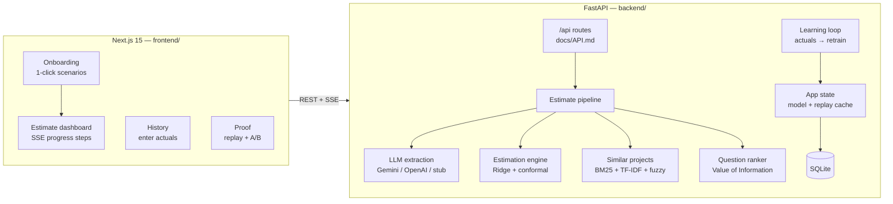

# The Estimator

**From RFP to range** — paste a customer email, get a calibrated effort estimate (P10/P50/P90), the highest-impact clarifying questions, and a learning loop that improves with every finished project.

> **Hackathon submission** — *Agent in the Shell* (Anduin Cybernetics) · Challenge #2: The Estimator.
> ⚠️ Demo data is **synthetic** and estimates are deliberately shown as a **range**, not a promise. See [Honest limitations](#honest-limitations).

**Live app:** _deploying — link TBD_ · **Docs:** [business spec](docs/SPEC.md) · [API contract](docs/API.md) · [decision log](docs/DECISIONS.md)

## Tóm tắt tiếng Việt

Dán email/RFP của khách → hệ thống trích xuất **15 features** (kèm trích dẫn gốc làm bằng chứng), ước lượng effort bằng **Ridge Regression + Conformal Prediction** trả về **khoảng P10/P50/P90** thay vì một con số, phát hiện thông tin còn thiếu và **xếp hạng câu hỏi làm rõ theo mức ảnh hưởng (ngày)**. Nhập số ngày thực tế khi dự án xong → hệ số cập nhật ngay, độ chính xác hiển thị theo thời gian. Màn **Proof** chứng minh hệ thống "học thật": Replay walk-forward (System vs Team vs LLM-only) + A/B so sánh độ dao động của LLM thuần. Chạy offline hoàn toàn bằng stub extractor; gắn `GEMINI_API_KEY` là dùng LLM thật ngay, không đổi code.

## The problem

- Effort estimates rely on Tech Lead gut feeling; nothing is learned from past projects.
- Missing requirements cause 20–40% scope creep; wrong estimates burn 15–30% of project margin.
- Estimating takes 1–3 hours per RFP — too slow to answer the customer in time.

## How it works

1. **Extract** — An LLM (or the offline stub) reads the email/RFP and extracts 15 binary features with verbatim evidence quotes. Evidence is verified with fuzzy matching; unclear items stay `unknown` instead of being guessed.
2. **Estimate** — Math, not the LLM, produces the estimate: Ridge regression on `log(days)` + split conformal prediction → **P10/P50/P90** with measurable coverage. Unknown inputs are never silently filled in — they become questions.
3. **Ask** — Each unknown feature is scored by Value of Information (impact in days) and turned into a concrete, ready-to-send clarifying question (VI + EN).
4. **Learn** — When a project finishes, entering actual days retrains the model, updates per-feature coefficients (sliding average, audit trail) and re-scores accuracy.
5. **Prove** — A walk-forward Replay re-predicts all history project-by-project (train on the past, predict the next) and compares System vs Team estimate vs LLM-only. No peeking at the future.

## Architecture



Design notes:

- **LLM does extraction only; math does estimation.** Same input → same output (std < 5%), auditable coefficients, no anchoring bias.
- **Replay is computed once at startup** (walk-forward over all history) and cached/served — the History and Proof screens read precomputed P10/P50/P90 values instead of retraining per request.
- **SSE streaming** (`POST /api/estimate/stream`) shows the pipeline steps live: extracting → validating → similar → estimating → questions → done.

## Why this is not "just an LLM wrapper"

| Criterion | LLM-only | This system |
|---|---|---|
| Consistency | ±15 day swings run-to-run | Same input → same output |
| Learning | None | Coefficients update from actuals; Ridge retrains |
| Uncertainty | A single number | P10/P50/P90 with measured coverage (75–85% target) |
| Auditability | Opaque | Every number traceable to coefficients + similar projects |
| Cost | Per-request LLM calls | LLM only for extraction; estimation is free math |
| Proof | — | Walk-forward Replay + A/B variance demo |

## The 15 features

Integration: `third_party_api`, `payment_gateway`, `identity_provider`, `external_data_sync` ·
Data: `data_migration`, `multi_currency`, `multi_tenancy` ·
UI: `realtime_ui`, `mobile_app`, `offline_mode` ·
Security: `pci_dss`, `privacy_compliance`, `audit_logging` ·
Context: `legacy_tech_stack`, `cross_team_coordination`

(Canonical list + definitions: [`backend/app/features.py`](backend/app/features.py))

## Quickstart (local)

```bash
# Backend — FastAPI on :8000
cd backend
python3 -m venv .venv && . .venv/bin/activate
pip install -r requirements.txt
bash scripts/run_api.sh            # seeds data/estimator.db from data/synthetic_history.csv on first run

# Frontend — Next.js on :3000
cd ../frontend
cp .env.local.example .env.local   # NEXT_PUBLIC_API_URL=http://localhost:8000
npm install && npm run dev
```

No API key required: without one the app uses the deterministic **stub extractor** and labels it in the UI. For real LLM extraction, set `GEMINI_API_KEY` in `.env` (see `.env.example`).

## Deploy (production)

**Backend → Render** (free tier): create a Blueprint from this repo — [`render.yaml`](render.yaml) configures the service (rootDir `backend`, health check `/api/health`). Set env vars in the dashboard:

- `CORS_ORIGINS` = your Vercel URL (e.g. `https://your-app.vercel.app`)
- optionally `LLM_PROVIDER=gemini` + `GEMINI_API_KEY` for real LLM extraction (stub otherwise)

> Note: on the free tier the SQLite file is ephemeral — the demo reseeds its 60 synthetic projects on every restart, so "entered actuals" are lost after a cold start. Expected for a demo.

**Frontend → Vercel**: import the same repo, set **Root Directory** to `frontend`, add env var `NEXT_PUBLIC_API_URL=https://your-backend.onrender.com`. Build settings are auto-detected (Next.js).

Alternative: `backend/Dockerfile` builds a self-contained API image for any container host (`docker build -f backend/Dockerfile .`).

## Demo scenarios (1-click)

Three realistic RFPs ship with the app (Onboarding → **Load Sample Data**):
**A** fintech (payments + PCI + mobile + real-time), **B** healthcare (legacy data migration, HIPAA, audit trail; offline hinted but ambiguous), **C** marketplace (multi-currency, multi-tenancy, SSO, vendor sync). Each runs the full pipeline and lands on a populated dashboard.

## Tests

86 backend tests (services + API integration), offline and deterministic:

```bash
cd backend && python -m pytest tests/ -q
```

> Bonus cross-dataset experiment on 5,850 real TAWOS Jira issues (negative result, honestly reported): [docs/TAWOS_VALIDATION.md](docs/TAWOS_VALIDATION.md)

## Honest limitations

1. **Demo data is synthetic** — generated by a hidden formula (documented in the generator, and ground truth is excluded from all services). Real-world numbers will differ.
2. **Story point ≠ person-day** — unit conversions are out of scope.
3. **Feature extraction can be wrong** — evidence verification + confidence values exist, but guardrails are not perfect.
4. **Conformal prediction assumes exchangeability** — distribution shift (new tech, new client types) can degrade coverage.
5. **No Jira/GitHub integration** — demo imports CSV only.
6. **No auth / multi-user** — single-user demo app; no roles or permissions.
7. **Baselines marked "simulated"** — the LLM-only baseline in Replay and the stub A/B run are simulation stand-ins (clearly flagged in API payloads and UI). With an API key, A/B runs real LLM calls.
8. **Similar projects retrieval** uses BM25 + TF-IDF (no embeddings) to keep the on-device build light.

## We do NOT claim

- "100% accurate"
- "Replaces humans" — it prepares questions and ranges for humans to decide
- "Works for every kind of project"
- "Works without historical data" — cold start still detects missing info and normalizes RFPs, but calibrated ranges need history

## Tech stack

| Layer | Choice |
|---|---|
| Frontend | Next.js 15 (App Router, TypeScript) + TailwindCSS + Recharts — dark, workflow-first, no chat UI |
| Backend | FastAPI + SSE streaming, SQLite |
| AI | Gemini Flash / OpenAI (pluggable) + deterministic offline stub |
| Math | scikit-learn Ridge + split conformal prediction |
| Tests | pytest — 86 offline tests |

## Repo layout

```
backend/   FastAPI app (app/api, app/services), tests, seed scripts
frontend/  Next.js 15 dashboard — onboarding, estimate, history, proof
data/      synthetic history CSV + ground truth (db is gitignored, auto-seeded)
docs/      SPEC.md (business spec), API.md (contract), DECISIONS.md (decision log)
```

## License

TBD before submission.
