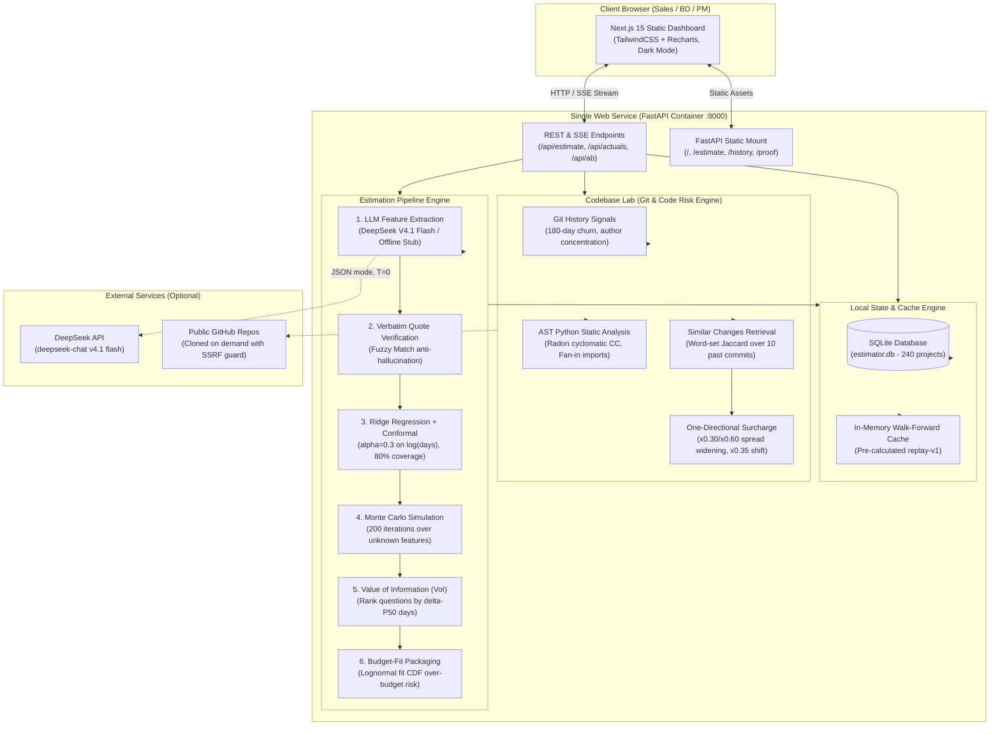

<div align="center">

# The Estimator
### From RFP to Calibrated Effort Range

[](https://the-estimator-xqzc.onrender.com)
[](https://github.com/iknizzz1807/the-estimator)
[-FF4B4B?style=for-the-badge)](https://github.com/iknizzz1807/the-estimator)

[](https://www.python.org/)
[](https://fastapi.tiangolo.com/)
[](https://nextjs.org/)
[](LICENSE)
[-success?style=flat-square)](backend/tests/)

**Biến email/RFP của khách hàng thành dải nỗ lực dự án chuẩn xác (P10/P50/P90), tự động trích xuất câu hỏi làm rõ quan trọng nhất, đóng gói báo giá theo ngân sách và liên tục học hỏi từ các dự án đã hoàn thành.**

---

### 📚 Toàn bộ tài liệu kỹ thuật & Báo cáo kiểm chứng (16 Documents)

| Tài liệu cốt lõi | Báo cáo kiểm chứng thực nghiệm (Empirical Reports) |
|---|---|
| 📋 [**SPEC.md**](docs/SPEC.md) — Đặc tả nghiệp vụ & Toán học | 📊 [**AB_MEASUREMENT.md**](docs/AB_MEASUREMENT.md) — So sánh 4 Baseline & Độ ổn định LLM |
| 🔌 [**API.md**](docs/API.md) — Đặc tả API Contract & Schema | 🎯 [**EXTRACTION_EVAL.md**](docs/EXTRACTION_EVAL.md) — Độ chính xác trích xuất 15 Features vs Ground Truth |
| 📝 [**DECISIONS.md**](docs/DECISIONS.md) — Nhật ký 29 Quyết định kiến trúc | 🔬 [**SURCHARGE_CALIBRATION.md**](docs/SURCHARGE_CALIBRATION.md) — Hiệu chuẩn phụ phí Codebase Lab trên 29k commits |
| 🎲 [**DATA_GENERATION.md**](docs/DATA_GENERATION.md) — Cơ chế sinh dữ liệu & Ground Truth | 🧪 [**CODEBASE_HISTORY_VALIDATION.md**](docs/CODEBASE_HISTORY_VALIDATION.md) — Kiểm chứng commit tương đồng (Positive: -2.8% MAE) |
| 🧭 [**USER_JOURNEY_GUIDE_PROPOSAL.md**](docs/USER_JOURNEY_GUIDE_PROPOSAL.md) — Thiết kế UI/UX | ⚠️ [**CODEBASE_VALIDATION.md**](docs/CODEBASE_VALIDATION.md) — Kiểm chứng SWE-bench text-prediction (Negative result) |
| 📦 [**SUBMISSION.md**](docs/SUBMISSION.md) — Bản đệ trình chính thức Hackathon | ⚠️ [**TAWOS_VALIDATION.md**](docs/TAWOS_VALIDATION.md) — Kiểm chứng 5,850 Jira stories TAWOS (Negative result) |
| 🔍 [**RETRIEVAL_VALIDATION.md**](docs/RETRIEVAL_VALIDATION.md) — Kiểm chứng Change Retrieval (Hit@10 đạt 80.7%) | ⚠️ [**ITEMLET_VALIDATION.md**](docs/ITEMLET_VALIDATION.md) — Kiểm chứng 114 dự án Itemlet (6.5% logged hours caveat) |
| | ⚠️ [**PR_LEADTIME_VALIDATION.md**](docs/PR_LEADTIME_VALIDATION.md) — Kiểm chứng PR Lead Time (Negative result: beta = -0.892) |
| | ⚠️ [**DISTILLATION_EXPERIMENT.md**](docs/DISTILLATION_EXPERIMENT.md) — Chưng cất LLM thành Classifier nhỏ (F1 0.442 vs 0.923) |

---

</div>

## 1. Tóm tắt điều hành (Executive Summary)

Trong các công ty dịch vụ phần mềm (Software Agency / Outsourcing / B2B SaaS), ước lượng nỗ lực (Effort Estimation) từ bản yêu cầu sơ khởi (RFP hoặc email khách hàng) luôn là một "canh bạc":
- **Thực trạng**: Tech Lead hoặc Project Manager (PM) thường ước lượng dựa trên **cảm tính (gut feeling)** và phán đoán chủ quan. Không có quy trình chuẩn để đối chiếu và học hỏi từ các dự án tương tự trong quá khứ.
- **Hậu quả**: Thiếu sót yêu cầu dẫn đến **20–40% scope creep**; ước lượng sai lệch đốt cháy **15–30% biên lợi nhuận** của dự án. 
- **Cái bẫy "Con số cố định" (The Fixed-Number Trap)**: Đưa ra một con số cố định duy nhất (ví dụ: *"Dự án này làm mất 100 ngày"*) là tự sát về mặt quản trị rủi ro. Mọi ước lượng phần mềm từ yêu cầu chưa rõ ràng bản chất là một phân phối xác suất, không bao giờ là một hằng số.

### Triết lý thiết kế: "LLM only reads — Math estimates"

Các giải pháp AI chatbot thông thường hiện nay đều thất bại khi đưa vào ứng dụng thực tế vì căn bệnh **bịa số (hallucination)** và nhầm lẫn bản chất toán học.

**The Estimator** được xây dựng trên một triết lý phân tách hoàn toàn trách nhiệm:
1. **LLM chỉ đọc và bóc tách dữ liệu**: Trích xuất chính xác 15 thuộc tính phân loại độ phức tạp phần mềm (Taxonomy Features) kèm **trích dẫn bằng chứng nguyên văn (verbatim evidence quotes)** được đối soát mờ (fuzzy match) với email gốc. Nếu email không đề cập rõ ràng, LLM bắt buộc phải gán `unknown`, tuyệt đối không được phép "đoán mò".
2. **Toán học thực hiện ước lượng**: Dải nỗ lực được tính toán bằng mô hình hồi quy chính quy hóa **Ridge Regression** trên không gian log-effort, kết hợp kỹ thuật **Conformal Prediction** hiệu chuẩn dải tin cậy 80% (P10/P50/P90), và lấy mẫu **Monte Carlo** dựa trên tần suất lịch sử của các feature còn thiếu.
3. **Workflow Dashboard thay vì Chatbot**: Không sử dụng giao diện hội thoại tự do. Hệ thống là một dashboard làm việc chuyên nghiệp, có bảng xếp hạng giá trị thông tin (Value of Information - VoI), cho phép PM trả lời trực tiếp từng câu hỏi để chứng kiến dải nỗ lực **co lại theo thời gian thực (live shrink)**.

### Pipeline 6 bước cốt lõi

```
┌──────────────┐     ┌──────────────┐     ┌──────────────┐
│  1. EXTRACT  │ ──> │ 2. ESTIMATE  │ ──> │ 3. ASK & VOI │
│ LLM bóc tách │     │  Ridge + CP  │     │ Co dải P10-90│
│  15 features │     │ Monte Carlo  │     │ qua câu hỏi  │
└──────────────┘     └──────────────┘     └──────────────┘
       │                                         │
       ▼                                         ▼
┌──────────────┐     ┌──────────────┐     ┌──────────────┐
│ 6. CODEBASE  │ <── │   5. LEARN   │ <── │   4. QUOTE   │
│ AST ma sát & │     │ Retrain trên │     │ Đóng gói gói │
│ commit rủi ro│     │ actual_days  │     │ theo budget  │
└──────────────┘     └──────────────┘     └──────────────┘
```

1. **Extract**: DeepSeek V4.1 Flash (hoặc Offline Stub) trích xuất 15 features chuẩn; kiểm tra phủ định (negation) và trích dẫn nguyên văn.
2. **Estimate**: Tính toán dải P10/P50/P90 bằng Ridge Regression ($\alpha = 0.3$) + Conformal Prediction. Những feature chưa rõ được lấy mẫu Monte Carlo làm giãn dải nỗ lực một cách trung thực (`method: "mc"`).
3. **Ask & Refine**: Xếp hạng các ẩn số theo mức độ ảnh hưởng số ngày ($\Delta\text{P50}$). PM bấm Có/Không để loại bỏ ẩn số → dải nỗ lực co lại tức thì, chuyển thành ước lượng điểm (`method: "point"`).
4. **Quote**: Nhập ngân sách của khách hàng → thuật toán tự động đề xuất 3 gói phạm vi (Essential / Standard / Full) kèm xác suất vượt ngân sách (tính qua khớp phân phối Lognormal).
5. **Learn**: Khi dự án kết thúc và nhập `actual_days`, hệ thống cập nhật trọng số tức thì, thích ứng tự động với độ lệch năng suất (+22% drift) trong khi con người giữ nguyên thói quen cũ.
6. **Codebase Lab (Tùy chọn)**: Trỏ vào kho mã nguồn Git → phân tích độ phức tạp AST (radon), churn, fan-in, nồng độ tác giả và 10 commit tương đồng trong quá khứ → bổ sung phụ phí rủi ro (*surcharge only, never discount*).

---

## 2. Nỗi đau thị trường & Câu chuyện sản phẩm (The Problem Statement)

### Vì sao các "AI Wrapper" / Chatbot thông thường thất bại thảm hại?

Nhiều đội ngũ cố gắng đưa prompt vào ChatGPT: *"Hãy ước lượng dự án này mất bao nhiêu ngày"*. Kết quả thu được là một thảm họa dự án:

1. **Ảo giác số liệu (Hallucination & Anchoring)**: LLM là mô hình ngôn ngữ dựa trên phân phối từ tiếp theo, hoàn toàn không có khả năng tính toán cộng dồn nỗ lực phần mềm. Khi gặp một con số ngân sách trong email, LLM bị "neo tâm lý" (anchoring bias) và bịa ra số ngày phù hợp với ngân sách đó thay vì độ phức tạp thực tế.
2. **Lẫn lộn chết người giữa Calendar Time và Person-Days**:
   - *Ví dụ đo được trong thực tế*: Dự án `P228` có thực tế làm hết **207 person-days** (đội 4 người làm trong khoảng 2.5 tháng).
   - Mô hình LLM-only trực tiếp đoán: **258 person-days** (hoặc hiểu nhầm thành calendar days kéo dài gần 1 năm làm việc). 
   - Sai số trung bình tuyệt đối (MAE) của LLM-only đo trên thực tế lên tới **258.12 ngày** (so với **17.36 ngày** của hệ thống The Estimator).
3. **Ảo tưởng về sự chắc chắn (Illusion of Certainty)**: LLM trả về một số duy nhất (ví dụ: "45 ngày"). Khi dự án phát sinh tích hợp PCI-DSS hoặc dữ liệu cũ bị bẩn, thời gian thực tế vọt lên 90 ngày → công ty chịu lỗ toàn bộ.
4. **Vấn đề thông tin thiếu sót**: Trong 100% các RFP ban đầu, thông tin luôn bị thiếu (khách không nói có cần mobile app không, có cần tuân thủ bảo mật không). Chatbot thông thường sẽ tự động giả định ngầm là "Không" hoặc hỏi lan man 40 câu hỏi không trọng tâm. Hệ thống cần định lượng **Giá trị của thông tin (Value of Information)** để chỉ hỏi 3–5 câu có tính quyết định nhất.

---

## 3. Kiến trúc hệ thống & Cơ chế chuyên sâu (Architecture & Deep Dive)

### Sơ đồ kiến trúc dịch vụ đơn (Single-Service Architecture)

The Estimator được đóng gói theo mô hình **Single Service** duy nhất: FastAPI phục vụ giao diện Next.js 15 tĩnh (Static HTML/JS Export) trên cùng một port. Không có rủi ro CORS, không phân mảnh deploy, không phụ thuộc database ngoài.



---

### Cơ chế chi tiết từng chặng (Detailed Engineering Steps)

#### Chặng 1: Bóc tách thuộc tính & Bằng chứng nguyên văn (Feature Extraction & Evidence)
- **15 Features phân loại**: Được quy chuẩn hóa trong [`backend/app/features.py`](backend/app/features.py), chia thành 5 nhóm rủi ro: Integration, Data, UI, Security, Context.
- **Trích xuất 3 giá trị**: Mỗi feature được phân loại thành `true` (1), `false` (0) hoặc `null` (Unknown).
- **Chống ảo giác trích dẫn (Anti-Hallucination Guard)**: Mỗi khẳng định phải có `evidence_quote` nguyên văn từ văn bản. Hệ thống chạy thuật toán so khớp chuỗi mờ (Fuzzy String Matching). Nếu tỷ lệ trùng khớp dưới 80%, trích dẫn bị đánh dấu cảnh báo.
- **Xử lý câu phủ định (Negation)**: Đạt độ chính xác 100% với DeepSeek (ví dụ: *"Không cần làm app mobile"* → gán chính xác `mobile_app = false` thay vì thấy chữ "mobile" là gán true).

#### Chặng 2: Ước lượng toán học — Ridge Regression, Conformal Prediction & Monte Carlo
Thay vì để LLM tự nghĩ ra số, toàn bộ việc tính toán do công thức toán học đảm nhiệm:

1. **Mô hình mục tiêu**: Huấn luyện hồi quy Ridge trên không gian log:

$$
\log(y) = \beta_0 + \sum_{i=1}^{15} \beta_i x_i + \epsilon
$$

   Với siêu tham số chính quy hóa $\alpha = 0.3$ (đã được tối ưu qua cross-validation sweep). Điểm ước lượng trung vị: $\text{P50} = \exp(\hat{y})$.

2. **Conformal Prediction (Đảm bảo dải tin cậy 80%)**:
   - Sử dụng phần dư ngoài mẫu (out-of-fold residuals) $r_i = \log(y_i) - \log(\hat{y}_i)$.
   - Tính toán phân vị thực nghiệm $q_{10}$ và $q_{90}$ với hiệu chỉnh mẫu hữu hạn và hệ số mở rộng đuôi $\times 1.10$:

$$
\text{P10} = \max\left(3.0, \exp(\hat{y} + q_{10})\right), \quad \text{P90} = \exp(\hat{y} + q_{90})
$$

   - Mức sàn cố định 3.0 person-days ngăn chặn ước lượng phi thực tế cho các module phần mềm.

3. **Mô phỏng Monte Carlo qua các ẩn số (Unknown Features)**:
   - Nếu $k$ features chưa rõ (`null`), hệ thống **không bao giờ gán mặc định là 0**.
   - Thực hiện 200 vòng mô phỏng Monte Carlo: mỗi feature chưa rõ được lấy mẫu $x_j^{(s)} \sim \text{Bernoulli}(p_j)$ với $p_j$ là tần suất xuất hiện lịch sử của feature đó.
   - Dải nỗ lực tự động **giãn rộng trung thực** (`method: "mc"`). Khi người dùng trả lời hết, phương thức tự động chuyển sang ước lượng điểm chuẩn xác (`method: "point"`).

#### Chặng 3: Value of Information (VoI) & Tương tác co dải theo thời gian thực
Để giải quyết bài toán thiếu thông tin, hệ thống đo lường độ nhạy của P50 đối với từng ẩn số:

$$
\Delta_j = \left| \text{P50}(x \mid x_j = 1) - \text{P50}(x \mid x_j = 0) \right|
$$

- Các câu hỏi được xếp hạng theo $\Delta_j$ giảm dần. Câu hỏi có tác động lớn nhất (ví dụ: `data_migration` hoặc `mobile_app` có thể làm lệch 20–40 ngày) được đưa lên đầu.
- Giao diện cung cấp nút **Có / Không** tương tác. Ngay khi PM bấm chọn, hệ thống cập nhật vector đặc trưng và **co dải P10–P90 ngay lập tức trên màn hình** (giảm độ bất định tương đối từ 1.99 xuống 1.38).

#### Chặng 4: Đóng gói báo giá theo ngân sách (Budget-Fit Packages)
Khách hàng đưa ra trần ngân sách $B$. Hệ thống phân rã phạm vi thành 3 gói:
- **Essential**: Chỉ giữ lại các tính năng nền tảng và bắt buộc, loại bỏ các tính năng tùy chọn tốn kém nhất.
- **Standard**: Cân bằng giữa tính năng và chi phí.
- **Full**: Toàn bộ 100% tính năng trích xuất.

Xác suất vượt ngân sách $P(\text{Days} > B)$ được tính toán qua khớp phân phối Lognormal từ dải Conformal (P10, P90) theo công thức:

$$
\mu = \log(\text{P50}), \quad \sigma = \frac{\log(\text{P90}) - \log(\text{P10})}{2 \times 1.2816}
$$

$$
P(\text{Over Budget}) = 1 - \Phi\left(\frac{\log(B) - \mu}{\sigma}\right)
$$

#### Chặng 5: Vòng lặp học liên tục (Continuous Learning Loop)
- Khi dự án bàn giao, PM nhập `actual_days`. Hệ thống lưu trữ vào cơ sở dữ liệu và **tái huấn luyện mô hình tức thì**.
- Bảng vết kiểm toán (audit trail) cập nhật sự thay đổi của từng hệ số $\beta_i$.
- **Khả năng thích ứng với Drift**: Dữ liệu có một cú nhảy năng suất +22% từ tháng 02/2026. Trong khi ước lượng con người bị tụt hậu do thói quen cũ, vòng lặp học của The Estimator nhanh chóng điều chỉnh trọng số và thu hẹp sai số.

#### Chặng 6: Codebase Lab — Đánh giá ma sát mã nguồn thực tế
Nếu dự án làm trên một kho mã nguồn có sẵn, The Estimator có thể phân tích trực tiếp repo Git:

- **Chỉ số ma sát cấu trúc ($F \in [0, 1]$)**:

$$
F = 0.25 \cdot \text{churn} + 0.20 \cdot \text{fan-in} + 0.25 \cdot \text{complexity} + 0.15 \cdot \text{coverage-gap} + 0.15 \cdot \text{author-concentration}
$$

  - `churn`: Số commit sửa đổi trong 180 ngày gần nhất (saturate tại 200).
  - `fan_in`: Phân tích AST các lệnh import Python (saturate tại 8).
  - `complexity`: Độ phức tạp Cyclomatic trung bình đo bằng Radon (saturate tại 20).
  - `author_concentration`: Tỷ lệ tập trung code của top committers (nguy cơ Bus Factor).

- **Commit tương đồng (Similar Past Changes)**: Truy xuất 10 commit có mô tả tương đồng nhất qua Jaccard similarity. Đo lường hình dạng thay đổi thực tế của chúng (trên chính repo này: 96% là sửa đổi file có sẵn — D27).

- **Quy tắc phụ phí một chiều (Surcharge only, never discount)**:

$$
\begin{aligned}
\text{P10}_{\text{adj}} &= \text{P10} \times (1 + F \times 0.30) \\
\text{P50}_{\text{adj}} &= \text{P50} \times (1 + \text{Invasiveness} \times 0.35) \\
\text{P90}_{\text{adj}} &= \text{P90} \times (1 + F \times 0.60)
\end{aligned}
$$

  Một codebase sạch sẽ **không bao giờ được giảm giá** (để tránh under-quoting), nhưng một codebase rác rưởi sẽ lập tức làm phình to dải rủi ro để bảo vệ đội ngũ phát triển.

---

## 4. Bảng số liệu thực nghiệm đầy đủ (Hard Numbers & Measured Results)

Toàn bộ các con số dưới đây đều được đo đạc thực nghiệm từ mã nguồn và dữ liệu thực, được lưu trữ có thể kiểm chứng tại [`docs/AB_MEASUREMENT.md`](docs/AB_MEASUREMENT.md) và [`docs/EXTRACTION_EVAL.md`](docs/EXTRACTION_EVAL.md).

### 1. So sánh 4 Baseline thực tế (Walk-Forward Replay trên 228 dự án)

Đo lường trên tập dữ liệu lịch sử 240 dự án (228 đã hoàn thành, 218 bước replay walk-forward, Provider: DeepSeek V4.1 Flash, Nhiệt độ $T=0$):

| Phương pháp (Baseline) | MAE (Toàn bộ 218 bước) | MAE (42 bước gần nhất) | Độ phủ P10–P90 (Coverage) | Ghi chú & Bản chất đo lường |
|---|:---:|:---:|:---:|---|
| **The Estimator System (Calibrated P50)** | **17.36 ngày** | **19.25 ngày** | **86.7%** (189/218) | **Mô hình kết hợp Ridge + Conformal; không rò rỉ tương lai** |
| **Team Estimate (Chuyên gia con người)** | 32.93 ngày | 42.45 ngày | — | Đánh giá chủ quan của PM/Tech Lead; bỏ qua drift năng suất |
| **LLM + Lịch sử công ty trong Prompt** | — | 35.27 ngày | — | Cung cấp 15 dự án gần nhất vào context prompt (Trung bình 3 lần gọi) |
| **LLM-only (Zero-shot)** | — | **258.12 ngày** | — | Gọi trực tiếp prompt yêu cầu đoán số ngày; nhầm lẫn nặng về quy mô |

#### Khả năng thích ứng hậu Drift năng suất (+22% từ 02/2026)
Trong 10 dự án cuối cùng sau khi xảy ra biến động năng suất:
- **The Estimator System**: Đạt **31.05 ngày MAE** (Độ phủ 7/10 đạt chuẩn).
- **Team Estimate con người**: Bị vọt sai số lên **52.90 ngày MAE** (do con người vẫn ước lượng theo thói quen cũ trước drift).

---

### 2. Thử nghiệm độ ổn định ở Nhiệt độ 0 (Variance Probe)

Để kiểm chứng giả thuyết *"LLM đoán sai là do phương sai ngẫu nhiên"*, chúng tôi thực hiện 5 lần gọi lặp lại độc lập trên cùng một email phức tạp (`P228`) ở $T=0$:

- **Kết quả 5 lần lặp**: `[180, 180, 180, 180, 180]` ngày.
- **Giá trị trung bình**: 180.00 ngày.
- **Độ lệch chuẩn (Std Dev)**: **0.000 ngày (0.0%)**.
- **Kết luận kiến trúc**: Ở $T=0$, mô hình LLM hoàn toàn tiền định (deterministic). Vấn đề của LLM không nằm ở phương sai chạy lại (variance), mà nằm ở **độ lệch chuẩn xác định lượng (calibration error)**. Lợi thế cốt lõi của The Estimator là **hiệu chuẩn toán học, khả năng kiểm toán và vòng lặp học thích ứng**.

---

### 3. Đánh giá chất lượng trích xuất (Extraction Quality vs Ground Truth)

Đo lường trên toàn bộ 240 email dự án với 3,600 ô thuộc tính đã biết trước sự thật (Ground Truth):

| Chỉ số đánh giá (Metric) | Offline Stub (Quy tắc regex) | DeepSeek V4.1 Flash |
|---|:---:|:---:|
| **Micro Precision** | 0.825 | **0.986** |
| **Micro Recall** | 0.867 | **0.886** |
| **Micro F1-Score** | 0.845 | **0.933** |
| **Macro F1-Score** | 0.843 | **0.936** |
| **Nhận diện phủ định (Negation Accuracy: "Không cần X" → 0)** | 43.1% (94/218) | **100.0% (214/214)** |
| **Độ chính xác ẩn số (Unknown Accuracy on Omitted)** | 98.1% (102/104) | **99.0% (103/104)** |
| **Tỷ lệ gán nhầm 0 khi có nhắc đến (Wrongly absent)** | 0.1% (1/812) | **0.0% (0/796)** |
| **Thời gian xử lý trung bình / email** | 0.003 giây | 3.314 giây |
| **Tổng chi phí toàn bộ 240 dự án (Peak / Off-peak)** | `$0.00` (Offline) | **`~$0.20 / ~$0.10`** |

---

### 4. Dữ liệu Demo Seeded chuẩn xác
- **240 dự án**: 228 dự án đã hoàn thành (tạo nên lịch sử học tập phong phú), 12 dự án đang thực hiện hoặc chờ xử lý.
- **Seed 42 tiền định**: Toàn bộ dữ liệu, phân phối Lognormal, các cụm tương tác (Interaction Multipliers) và danh sách ngoại lai (Outliers) đều tái lập chính xác từng byte.

---

## 5. Thừa nhận trung thực & Các kết quả âm tính (Honest Limitations & Negative Results)

Một trong những giá trị văn hóa kỹ thuật cao nhất của The Estimator là **tuyệt đối không "vẽ" số liệu marketing**. Mọi thử nghiệm thất bại hoặc giới hạn đều được ghi nhận công khai và chi tiết trong thư mục `docs/`:

### 1. Tập dữ liệu TAWOS: Kết quả âm tính ($R^2 \approx -0.02$)
- **Thực nghiệm** ([`docs/TAWOS_VALIDATION.md`](docs/TAWOS_VALIDATION.md)): Chạy mô hình trên **5,850 Jira issues thật từ 39 dự án mã nguồn mở**.
- **Kết quả**: $R^2 = -0.021$, MAE = 2.48 Story Points → Mô hình chỉ hòa điểm với đường baseline trung vị toàn cục (2.48 SP).
- **Bài học rút ra**: **Story Point ≠ Person-Day**. Từ vựng trên Jira task quá vụn vặt và không tương thích với ngôn ngữ mô tả yêu cầu trong RFP tổng thể. Chúng tôi báo cáo thẳng thắn kết quả này và không cố tình tinh chỉnh số liệu.

### 2. SWE-bench Text-Prediction: Không thể đoán độ xâm lấn mã nguồn từ văn bản issue
- **Thực nghiệm** ([`docs/CODEBASE_VALIDATION.md`](docs/CODEBASE_VALIDATION.md)): Thử nghiệm dùng văn bản issue (kèm tín hiệu codebase tại commit gốc) để dự đoán số file bị sửa đổi trên 2,294 bài toán SWE-bench.
- **Kết quả**: Thêm tín hiệu codebase không làm giảm MAE (1.389 vs 1.318).
- **Định vị sản phẩm**: Module Codebase Lab được giữ đúng vị thế là **"Giải thích rủi ro" (Risk Explanation)**, tuyệt đối không được quảng cáo sai lệch là "mô hình dự đoán chính xác kích thước patch".

### 3. Tập dữ liệu Itemlet: Giới hạn bởi chất lượng ghi nhận giờ làm (Logging Coverage)
- **Thực nghiệm** ([`docs/ITEMLET_VALIDATION.md`](docs/ITEMLET_VALIDATION.md)): Kiểm chứng trên 114 dự án phần mềm có ghi nhận giờ công thực tế.
- **Kết quả**: Độ phủ dải tin cậy Conformal đạt chuẩn xuất sắc (**76.3% – 86.0%** so với mục tiêu 75–85%). Tuy nhiên, ước lượng điểm chỉ hòa baseline do chỉ có **6.5% tổng số issues** trong dự án có ghi log giờ làm việc. (Trên tập con 37 dự án có tỷ lệ log ≥ 10%, mô hình đạt $R^2 = 0.364$, vượt trội hoàn toàn baseline).

### 4. Nghiên cứu PR Lead-Time: Bị bác bỏ hoàn toàn ($\beta = -0.892$)
- **Thực nghiệm** ([`docs/PR_LEADTIME_VALIDATION.md`](docs/PR_LEADTIME_VALIDATION.md)): Thử nghiệm dùng thời gian đóng PR trên GitHub (`merged_at - created_at`) trên 3,240 PRs làm thước đo thay thế cho nỗ lực.
- **Kết quả**: Hệ số ma sát ra số âm ($\beta = -0.892$) do các thư viện mở merge PR trong ngày (median 0.4 ngày) và phụ thuộc vào quy trình review của maintainer chứ không phản ánh nỗ lực code. Hệ thống đã **loại bỏ hoàn toàn** hướng tiếp cận này.

### 5. Chưng cất mô hình (Distillation): Học sinh chưa thể thay thế Giáo viên
- **Thực nghiệm** ([`docs/DISTILLATION_EXPERIMENT.md`](docs/DISTILLATION_EXPERIMENT.md)): Huấn luyện mô hình Logistic Regression + TF-IDF nhỏ từ nhãn của DeepSeek trên 240 dự án.
- **Kết quả**: Học sinh chỉ đạt Micro-F1 **0.442** (so với 0.923 của giáo viên) và đường cong học tập bị bão hòa. Muốn thay thế hoàn toàn LLM bằng mô hình phân loại nhỏ chạy offline, doanh nghiệp cần tối thiểu hàng nghìn mẫu RFP thực tế.

### 6. Bản chất của các hệ số Codebase Lab
- Hệ số tương quan giữa ma sát và độ phình kích thước commit đã được chứng minh dương tính trên **29,059 commit thật** ([`docs/SURCHARGE_CALIBRATION.md`](docs/SURCHARGE_CALIBRATION.md)).
- Tuy nhiên, việc quy đổi từ độ xâm lấn commit ra **person-days** hiện tại mang tính **giả định demo (demo-assumed constants)**: $\times 0.30 / \times 0.60$ giãn dải và $\times 0.35$ dịch P50. Việc hiệu chuẩn tuyệt đối cần dữ liệu triplet `(Repo, RFP, Actual Person-Days)` nội bộ của từng công ty.

### 7. Hạ tầng lưu trữ Render Free Tier
- SQLite lưu trên ổ đĩa tạm (ephemeral filesystem). Khi instance Render khởi động lại sau thời gian ngủ (cold start), file cơ sở dữ liệu sẽ tự động reseed về 240 dự án mẫu ban đầu. Hệ thống cung cấp nút bấm **"Reset demo data"** để khôi phục trạng thái chuẩn bất kỳ lúc nào.

---

## 6. Bảng phân loại 15 Thuộc tính Phần mềm (The 15 Features Taxonomy)

Được định nghĩa chuẩn hóa trong [`backend/app/features.py`](backend/app/features.py) và là ngôn ngữ chung xuyên suốt giữa LLM, mô hình toán và giao diện:

| Nhóm (Group) | Tên thuộc tính (Feature Key) | Mô tả định nghĩa nghiệp vụ | Trọng số sinh mẫu ($\beta$) | Tần suất xuất hiện ($P$) |
|---|---|---|:---:|:---:|
| **Integration** | `third_party_api` | Tích hợp API bên thứ ba (CRM, ERP, cổng đối tác) | × 1.35 | 45% |
| | `payment_gateway` | Cổng thanh toán trực tuyến (thẻ, ví điện tử) | × 1.45 | 25% |
| | `identity_provider` | Đăng nhập tập trung SSO / OAuth / Okta / SAML | × 1.25 | 25% |
| | `external_data_sync` | Đồng bộ dữ liệu liên tục 2 chiều với hệ thống ngoài | × 1.30 | 30% |
| **Data** | `data_migration` | Di chuyển, làm sạch dữ liệu từ cơ sở dữ liệu cũ | × 1.60 | 30% |
| | `multi_currency` | Xử lý đa tiền tệ, tỷ giá hối đoái tự động | × 1.15 | 15% |
| | `multi_tenancy` | Kiến trúc đa người thuê (chia sẻ nền tảng, cô lập dữ liệu) | × 1.50 | 20% |
| **UI** | `realtime_ui` | Giao diện cập nhật thời gian thực (< 100ms, WebSocket) | × 1.30 | 25% |
| | `mobile_app` | Ứng dụng di động Native (iOS/Android), không phải web responsive | × 1.55 | 25% |
| | `offline_mode` | Khả năng hoạt động offline và đồng bộ lại khi có mạng | × 1.25 | 20% |
| **Security** | `pci_dss` | Tuân thủ bảo mật thanh toán thẻ ngân hàng PCI-DSS | × 1.40 | 20% |
| | `privacy_compliance` | Tuân thủ nghiêm ngặt quyền riêng tư GDPR / HIPAA | × 1.35 | 25% |
| | `audit_logging` | Ghi vết kiểm toán chi tiết từng thao tác người dùng | × 1.20 | 20% |
| **Context** | `legacy_tech_stack` | Làm việc với công nghệ cũ (hệ thống on-premise, code cũ) | × 1.45 | 20% |
| | `cross_team_coordination` | Phối hợp đa phòng ban, nhiều vendor và bên liên quan | × 1.25 | 25% |

*Các tương tác phi tuyến (Interactions)*: `payment_gateway` × `pci_dss` (+15%), `mobile_app` × `offline_mode` (+10%), `data_migration` × `legacy_tech_stack` (+12%).

---

## 7. Khởi chạy nhanh & Triển khai (Quickstart & Deployment)

### Yêu cầu môi trường
- Python 3.12+ (khuyến nghị Python 3.12 hoặc 3.13)
- Node.js 20+ (nếu cần build lại giao diện)
- Git (để chạy Codebase Lab)

---

### Cách 1: Chạy Local 1 Cổng duy nhất (Khuyến nghị)

```bash
# 1. Clone repository
git clone https://github.com/iknizzz1807/the-estimator.git
cd the-estimator

# 2. Cài đặt backend
cd backend
python -m venv .venv

# Trên Linux/macOS:
source .venv/bin/activate
# Trên Windows PowerShell:
# .\.venv\Scripts\Activate.ps1

pip install -r requirements.txt

# 3. Chạy toàn bộ ứng dụng (FastAPI phục vụ cả UI và API trên cổng 8000)
bash scripts/run_api.sh
# Hoặc chạy trực tiếp bằng python:
# python -m uvicorn app.main:app --host 0.0.0.0 --port 8000
```

Mở trình duyệt tại: **`http://localhost:8000`**

> [!NOTE]
> - Mặc định ứng dụng chạy ở chế độ **Offline Stub Extractor**: Không cần bất kỳ API key nào, kiểm thử 100% offline với tốc độ cực nhanh.
> - Để kích hoạt LLM DeepSeek thật, chỉ cần copy file cấu hình và điền API key:
>   ```bash
>   cp .env.example .env
>   # Điền DEEPSEEK_API_KEY=sk-... và đặt LLM_PROVIDER=deepseek
>   ```

---

### Cách 2: Chạy kiểm thử tự động (242 Tests Offline)

Toàn bộ 242 bài kiểm thử backend đều độc lập mạng và sử dụng stub extractor tiền định:

```bash
cd backend
python -m pytest tests/ -q
```
*(Đảm bảo kết quả 100% passed).*

---

### Cách 3: Đóng gói Docker & Triển khai Production

Ứng dụng được đóng gói qua Dockerfile đa tầng (Multi-stage build) cực kỳ tối ưu:
```bash
# Build image duy nhất chứa cả Next.js static export và FastAPI
docker build -f backend/Dockerfile -t the-estimator .

# Khởi chạy container
docker run -d -p 8000:8000 --name estimator the-estimator
```

#### Triển khai Render (Infrastructure as Code)
Repository đã đính kèm file cấu hình [`render.yaml`](render.yaml). Trên Render Dashboard:
1. Nhấn **New +** → **Blueprint**.
2. Trỏ vào repo `iknizzz1807/the-estimator`.
3. Render sẽ tự động dựng dịch vụ Docker Web Service, cấu hình health-check tại `/api/health` và phát hành tại domain miễn phí.

---

## 8. Lộ trình phát triển tương lai (Future Roadmap)

1. **Jira & Harvest Webhook Integration**: Tự động đồng bộ các dự án hoàn thành từ Jira Software và công cụ chấm công Harvest/Toggl để cập nhật vòng lặp học tập mà không cần nhập tay `actual_days`.
2. **Two-Stage Codebase Regression**: Khi doanh nghiệp tích lũy đủ dữ liệu triplet `(Repo, RFP, Actual Effort)`, đưa các biến ma sát mã nguồn trực tiếp vào ma trận hồi quy Stage-1 thay vì sử dụng hệ số phụ phí quy ước.
3. **Hỗ trợ Đa ngôn ngữ cho Codebase Lab**: Mở rộng bộ phân tích AST và Fan-in sang TypeScript/JavaScript, Go, Java và Rust (thay thế cho quy tắc Python-only hiện tại).
4. **Multilingual Embedding Retrieval cho tiếng Việt**: Triển khai mô hình nhúng câu đa ngữ để tìm kiếm tương đồng trên các RFP thuần tiếng Việt có văn phong đặc thù.

---

## 9. Cấu trúc thư mục (Repository Layout)

```
the-estimator/
├── backend/                  # Dịch vụ FastAPI, mô hình toán & Codebase Lab
│   ├── app/
│   │   ├── api/              # Các REST endpoints & SSE stream
│   │   ├── data_gen/         # Generator sinh 240 dự án mẫu chuẩn xác
│   │   ├── services/         # Pipeline cốt lõi: estimation, extraction, codebase, voi
│   │   ├── features.py       # Single source of truth cho 15 features
│   │   └── main.py           # FastAPI entrypoint & mount Next.js export
│   ├── scripts/              # Các script đo lường A/B, kiểm chứng thực nghiệm
│   ├── tests/                # 242 bài kiểm thử đơn vị & tích hợp
│   ├── Dockerfile            # Multi-stage production container
│   └── requirements.txt      # Dependencies (scikit-learn, radon, fastapi...)
├── frontend/                 # Giao diện Next.js 15 (TailwindCSS, Recharts)
│   ├── app/                  # App router: /estimate, /history, /proof
│   ├── components/           # Các widgets chuyên biệt (CodebasePanel, VoI...)
│   ├── lib/                  # Types, journey config, helpers
│   └── out/                  # Thư mục build HTML tĩnh (phục vụ bởi FastAPI)
├── data/                     # Dữ liệu 240 dự án (synthetic_history.csv, demo repos)
├── docs/                     # 16 tài liệu kỹ thuật, đặc tả và báo cáo thực nghiệm
├── render.yaml               # Blueprint khai báo hạ tầng triển khai Render
└── README.md                 # Tài liệu hướng dẫn chính của dự án
```

---

<div align="center">

**The Estimator — Engineering calibrated software effort ranges with honesty and rigor.**  
*Xây dựng bởi đội ngũ kỹ sư tham dự cuộc thi "Agent in the Shell" — Anduin Cybernetics.*

</div>
